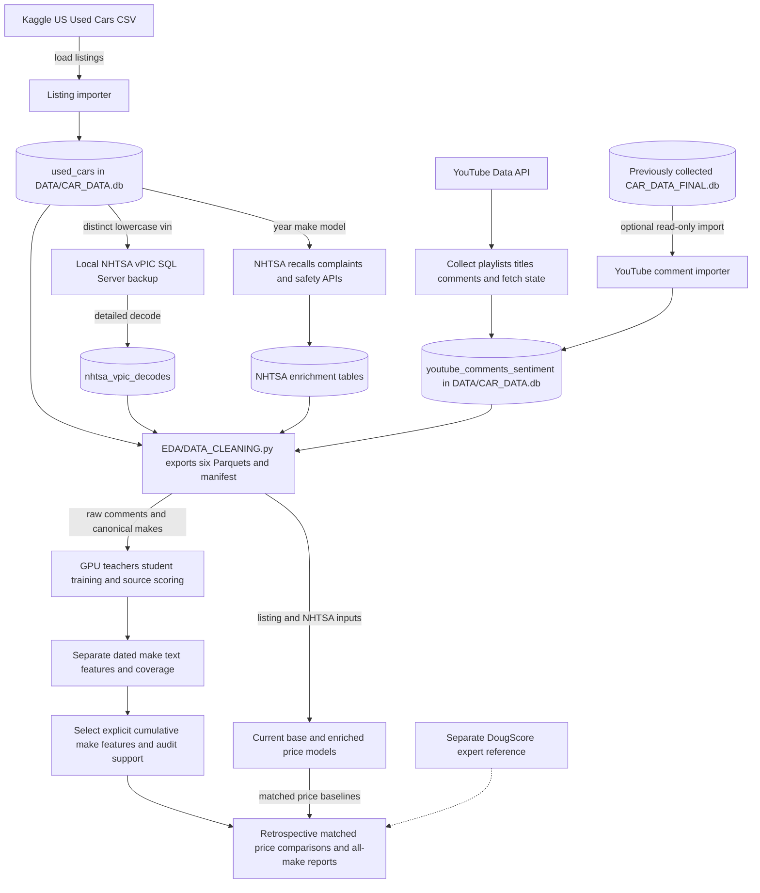
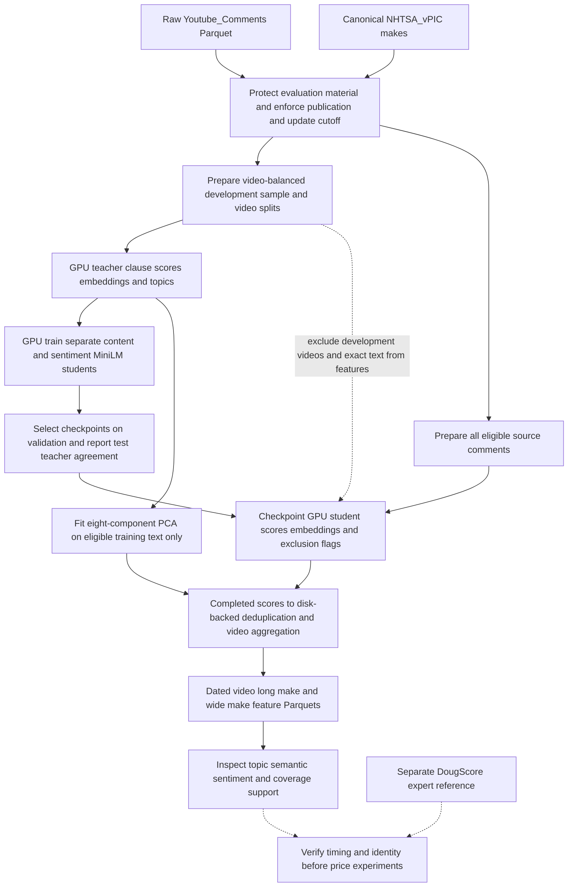
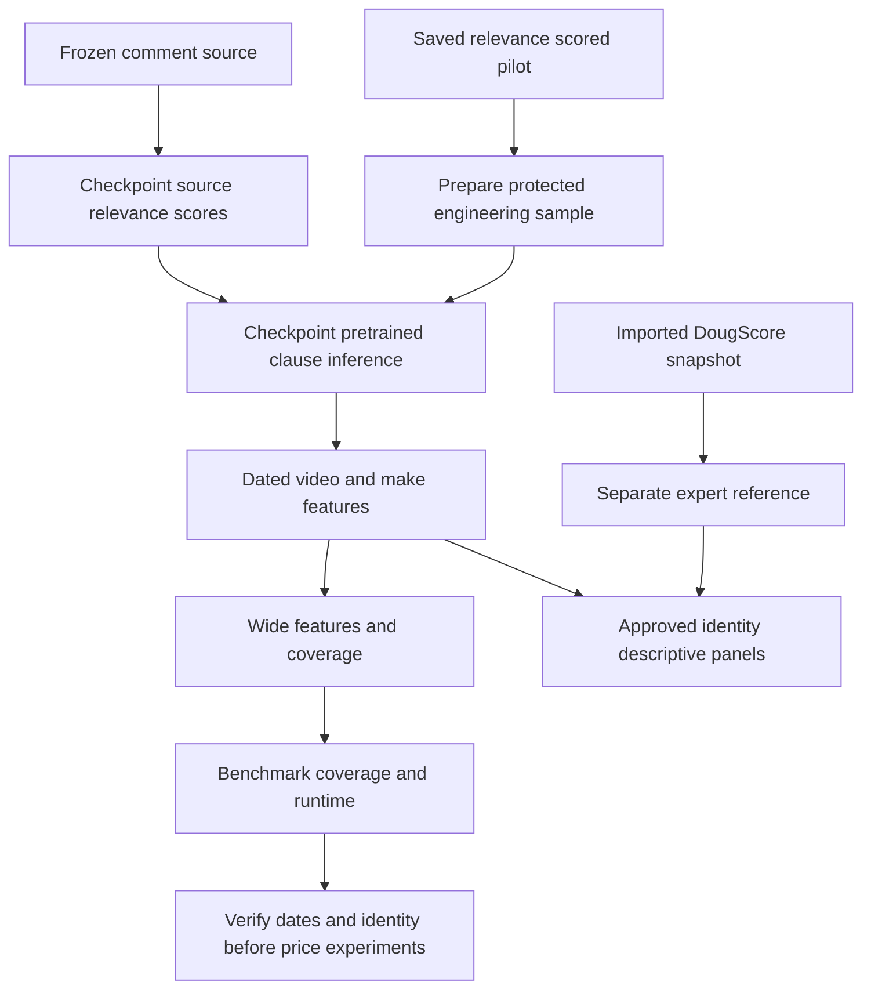
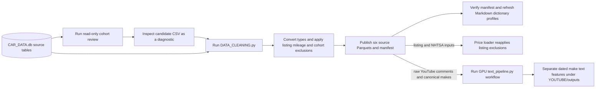
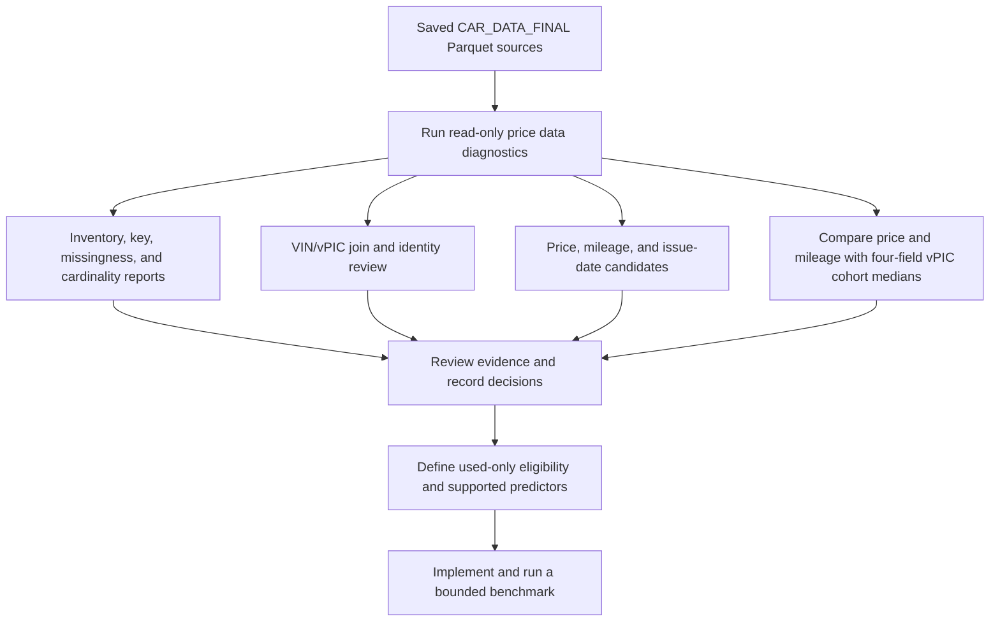
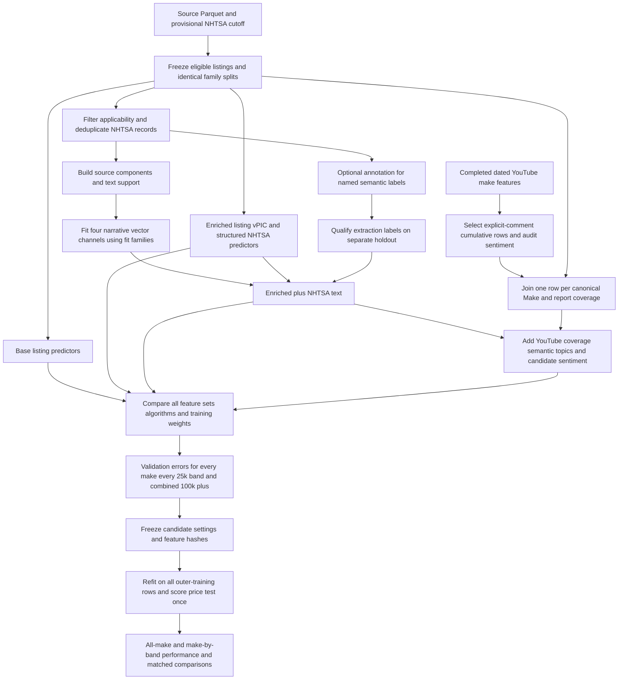
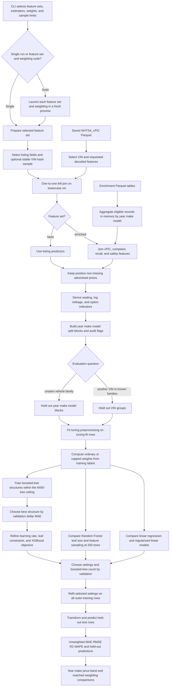

# DataScience Capstone Cars

This repository contains the working files for a car-focused data science capstone. It collects used-car listings, NHTSA vPIC decoding, safety ratings, complaints, recalls, and YouTube comments into a six-source Parquet snapshot. The price comparison workflow supports listing-only, structured NHTSA-enriched, NHTSA text, and selected YouTube make features on matching price splits, with performance for every make and price band. The YouTube process trains GPU text classifiers and generates dated make-level semantic, topic, sentiment, and coverage candidates; DougScore remains a separate expert reference.

## Repository structure

| Path | Purpose |
| --- | --- |
| `DATA/` | Local source files and generated `CAR_DATA.db`; data files are generally not tracked by Git. |
| `NHTSA/` | Listing ingestion, NHTSA API collection, local vPIC decoding, SQL Server restore, and the staged complaint/recall text-feature experiment. |
| `YOUTUBE/` | API collection/import; `text_pipeline.py` and `text/` for GPU teacher scoring, student training, full-source scoring, and dated make features; preserved relevance/sentiment benchmarks. |
| `EXPERT_REVIEWS/` | DougScore audit, snapshot import, expert-aspect baseline, and vehicle candidate review alongside sentiment. |
| `EDA/` | Exploratory analysis notebooks and scripts, including the cleaning and Parquet export script. |
| `MODELS/` | Price-model training, evaluation, and read-only data preflight diagnostics. |
| `MODEL_OUTPUT.ipynb` | Inspect saved price-model runs and comparison reports. |
| `MODEL_OUTPUT/` | Local model runs, diagnostics, and frozen experiments; only `.gitkeep` is tracked. |
| `README.md` | Project setup, data lineage, and workflow. |
| `DATA_DICTIONARY.md` | Data-specific documentation for the model dataset. |
| `AGENTS.md` | Repository working and documentation-maintenance instructions. |

## Data sources and lineage

| Source | Origin and local input | How it enters the project |
  | --- | --- | --- |
| Used car listings (model dataset) | [US Used Cars Dataset on Kaggle](https://www.kaggle.com/datasets/ananaymital/us-used-cars-dataset); obtain the CSV from the dataset page and place it at `DATA/used_cars_data.csv`. The dataset is described as CarGurus listing data. | `NHTSA/build_car_data_db.py --load-only` streams CSV rows into `used_cars` in `DATA/CAR_DATA.db`; all source columns are retained as text. |
  | NHTSA vPIC VIN decoding | [NHTSA standalone vPIC database downloads](https://vpic.nhtsa.dot.gov/Downloads); the repository restore script is configured for `DATA/vPICList_lite_2026_09.bak`. The downloaded SQL Server backup is VIN-decoding data, not the listings dataset. | Restore as `vPICList_Lite`; the importer reads distinct listing VINs in chunks of up to 100, calls `dbo.spVinDecode` for each VIN with private and all-variable output enabled, and stores all returned variables as columns in `nhtsa_vpic_decodes`; `nhtsa_vpic_variable_metadata` records NHTSA labels, variable IDs, groups, and `DataType`. No vPIC API call is made for this step. |
| NHTSA recalls, complaints, and safety ratings | Live [NHTSA APIs](https://api.nhtsa.gov/), queried from distinct listing model-year/make/model combinations. | Opt-in requests are written to separate enrichment tables in `CAR_DATA.db`; recall and complaint makes/models are checked against NHTSA product catalogs before requests. |
| YouTube comments | The [YouTube Data API](https://developers.google.com/youtube/v3) supplies playlist videos, titles, and top-level comments. `YOUTUBE/YOUTUBE_COMMENTS_API.py` is the project-local collector. A previously collected `youtube_comments_sentiment` table also exists at `E:\Car-Price-Data-Visualization-Learning\CAR_DATA_OUTPUT\CAR_DATA_FINAL.db`. | The collector writes directly to `DATA/CAR_DATA.db`, tracking playlist/video fetch state and refreshing completed videos on its configured schedule. `YOUTUBE/import_youtube_comments.py` remains available to copy the already-existing external table into the project database in read-only source mode. Neither step calculates sentiment scores. |
| DougScore expert reviews | User-supplied `C:/Users/danie/Downloads/DougScore - DougScore.csv`; category definitions from [Doug DeMuro](https://www.dougdemuro.com/dougscore). | 585 reviews are imported into separate expert baseline tables under `EXPERT_REVIEWS/outputs/dougscore_v1/`; the six source tables and price model do not consume them yet. |

All six sources are exported separately under `DATA/CAR_DATA_FINAL/`. The listing CSV is the base; vPIC is associated by lowercase `vin`, and safety, complaints, and recalls are collected by model year, make, and model. YouTube comments retain their video and playlist metadata in `Youtube_Comments.parquet`. The GPU text workflow derives make-level features in `YOUTUBE/outputs/`, using canonical `NHTSA_vPIC.Make` values for attribution. The comparison runner selects a single make view, checks its hashes/grain/support, and records the timing limitation as retrospective association. DougScore remains separate. Source fields, grains, and linkage considerations are in [DATA_DICTIONARY.md](DATA_DICTIONARY.md).

## Data workflow



## Setup

The project requires Python. `pyodbc` is used for local vPIC decoding and `google-api-python-client` is used by the YouTube API collector. Configure a YouTube Data API key as `YOUTUBE_API_KEY` or `GOOGLE_API_KEY` in the environment, in the project-root `.env` file, or provide a key file to the script. Install the [Microsoft ODBC Driver for SQL Server](https://learn.microsoft.com/en-us/sql/connect/odbc/download-odbc-driver-for-sql-server) and SQL Server 2019 or newer if using the local vPIC backup.

```powershell
python -m venv .venv
.\.venv\Scripts\python.exe -m pip install -r requirements.txt
```

Download the used-car CSV from Kaggle and save it as `DATA/used_cars_data.csv`. Load it without external queries:

```powershell
.\.venv\Scripts\python.exe NHTSA/build_car_data_db.py --load-only
```

To enable local VIN decoding, download and extract the SQL Server backup from the NHTSA downloads page into `DATA/vPICList_lite_2026_09.bak`, then restore it as `vPICList_Lite`. The guarded restore script only creates the database if it does not already exist. Run it from an Administrator PowerShell session with SQL Server running:

```powershell
Start-Service MSSQLSERVER
& 'C:\Program Files\Microsoft SQL Server\Client SDK\ODBC\170\Tools\Binn\SQLCMD.EXE' -S localhost -E -b -i NHTSA\restore_vpic_database.sql
```

If the SQL Server service account cannot read the backup at that path, move the backup to a readable directory and update the `FROM DISK` path in `NHTSA/restore_vpic_database.sql`. Configure another SQL Server instance or database with `--vpic-server` and `--vpic-database`.

If starting `MSSQLSERVER` reports event 17051, the SQL Server Evaluation period has expired. The original local setup used SQL Server 2019 Enterprise Evaluation. From an Administrator session, run the cached SQL Server setup at `C:\Program Files\Microsoft SQL Server\150\Setup Bootstrap\SQL2019\setup.exe`, choose **Maintenance > Edition Upgrade**, select the `MSSQLSERVER` instance, and change it to Developer edition. If Setup cannot upgrade the expired instance, install a separate SQL Server Developer instance and restore vPIC there.

## Collection commands

Query-only runs leave the listing rows unchanged. With no `--only` option, the importer decodes distinct VINs locally from the already loaded `used_cars` table:

```powershell
.\.venv\Scripts\python.exe NHTSA/build_car_data_db.py
```

Run individual remote NHTSA collections explicitly:

```powershell
.\.venv\Scripts\python.exe NHTSA/build_car_data_db.py --only recalls
.\.venv\Scripts\python.exe NHTSA/build_car_data_db.py --only complaints
.\.venv\Scripts\python.exe NHTSA/build_car_data_db.py --only safety
```

Use `--only all` to collect recalls, complaints, safety variants and rating details, then locally decode VINs. Repeat `--only` flags to select multiple sources, such as `--only recalls --only complaints --only vpic`; these selections run sequentially in one process. Add `--load-listings` only when the CSV should also be loaded or refreshed. Use `--limit 100` for a small trial.

  For a bulk local vPIC run, first load the listings CSV with `--load-only`, then run `./.venv/Scripts/python.exe NHTSA/build_car_data_db.py --only vpic`. The decoder reads distinct non-empty VINs from `used_cars` in chunks. For every VIN it calls NHTSA's detailed `spVinDecode` with `IncludePrivate=1` and `IncludeAll=1`, storing each returned decoder variable as a column in `nhtsa_vpic_decodes`; variable names, NHTSA labels, IDs, groups, and `DataType` are recorded in `nhtsa_vpic_variable_metadata`. NULL values are preserved and do not prove a feature is absent. `--vpic-batch-size 25` reduces transaction chunk size; `--limit 100` caps a trial at 100 distinct VINs. NHTSA's `spVinDecodeMultiple` endpoint is not used for this full-variable path because it returns only summary fields.

Import YouTube comments from the configured source database with:

```powershell
.\.venv\Scripts\python.exe YOUTUBE/import_youtube_comments.py
```

Override the source or destination with `--source` and `--db`. Both scripts write to `DATA/CAR_DATA.db` by default. Large datasets, backups, databases, and model artifacts are local and ignored by Git unless intentionally added.

The API collector can discover its configured playlists and collect comments into the same project database:

```powershell
.\.venv\Scripts\python.exe YOUTUBE/YOUTUBE_COMMENTS_API.py
```

It reads playlist/video/comment limits and refresh options from command-line flags; use `--help` for the full list. Use `--playlist-id` or `--video-id` to target specific content, and `--output-db` to choose another SQLite destination. API collection can consume YouTube quota; fetch status and retry timing are stored so interrupted or rate-limited work can resume.

## YouTube GPU raw text workflow

`YOUTUBE/text_pipeline.py` is the current comment-processing entry point. It reads
raw `DATA/CAR_DATA_FINAL/Youtube_Comments.parquet`, learns two compact classifiers
from pretrained teacher predictions, then scores the eligible source snapshot
and aggregates dated make-level features. The previous supervised relevance model
is bypassed, and no new manual labels are needed. Implementation lives in
`YOUTUBE/text/`; setup, model choices, and detailed checks are in
[the GPU runbook](YOUTUBE/docs/GPU_TEXT_RUNBOOK.md).

### GPU environment

Run these commands from the repository root in the isolated `.venv-youtube`
environment. The local setup uses PyTorch 2.7.1 with CUDA 12.6 and FP16 on the
8 GB RTX 2060 Super. The existing `.venv` is CPU-only. For a new environment:

```powershell
python -m venv .venv-youtube
.\.venv-youtube\Scripts\python.exe -m pip install torch==2.7.1 --index-url https://download.pytorch.org/whl/cu126
.\.venv-youtube\Scripts\python.exe -m pip install -r YOUTUBE\requirements-gpu.txt
.\.venv-youtube\Scripts\python.exe YOUTUBE\text_pipeline.py doctor
```

`doctor` verifies an actual GPU kernel. Neural stages default to CUDA and fail
explicitly if it is unavailable. Public model weights are cached locally under
`YOUTUBE/.cache/huggingface`; inference and training run locally.

### Prepare development data, score teachers, and train students

`prepare` freezes the comment source, canonical vPIC makes, and an inclusive
publication **and update** cutoff. Invalid/post-cutoff dates, protected comment
IDs/videos/text, and the original reserved-video partition are excluded without
reading annotation scores. A seeded 25% development-video pool supplies rotating
video quotas and approximately 80/10/10 train/validation/test video splits.
Exact normalized text cannot cross those development partitions.

Teacher `score` caches clause evidence, content predictions, 384-dimensional
MiniLM embeddings, eight topic similarities, and eligible sentiment predictions.
DeBERTa routes content into vehicle opinions, vehicle facts/questions, creator
discussion, or irrelevant text; CardiffNLP supplies negative/neutral/positive
tone. `train` uses confident training-video pseudo-labels to fine-tune separate
MiniLM content and sentiment students with class balancing and FP16. Validation
teacher-agreement macro F1 selects checkpoints; test agreement is reported after
selection. The eight-component PCA reducer fits eligible training text only.

Development is already complete in the saved v1/v2/v3 artifacts below. To repeat
it, use fresh output directories, for example:

```powershell
.\.venv-youtube\Scripts\python.exe YOUTUBE\text_pipeline.py prepare --output-dir YOUTUBE\outputs\text_development_v4 --sample-size 20000 --as-of 2026-10-01
.\.venv-youtube\Scripts\python.exe YOUTUBE\text_pipeline.py score --input-dir YOUTUBE\outputs\text_development_v4 --output-dir YOUTUBE\outputs\text_teacher_v4 --backend teacher --device cuda --batch-size 32
.\.venv-youtube\Scripts\python.exe YOUTUBE\text_pipeline.py train --teacher-dir YOUTUBE\outputs\text_teacher_v4 --output-dir YOUTUBE\outputs\text_models_v4 --device cuda --batch-size 16 --accumulation 2 --epochs 3
```

### Current full-source run and saved artifacts

The saved run verified on **2026-10-06** uses the `2026-10-01` text cutoff.
`text_source_v1` preparation is complete: **1,287,155 eligible comments across
2,999 videos**, from the 1,981,686-comment source snapshot. Its audit records
694,531 exclusions for protected IDs/videos/text or reserved videos. The
`text_scored_v1/score_manifest.json` records completed scoring of all 1,287,155
comments and 2,872,698 clauses using the `text_models_v3` students.
`text_features_v1/feature_manifest.json` records completed aggregation: 273 wide
make rows, 2,184 long make/aspect rows, and 312,696 video feature rows across the
separate attribution/window policies. The selected explicit-comment/cumulative
price export has 83 makes, 73 with semantic/topic support, and 46 candidate fields.

| Saved location under `YOUTUBE/outputs/` | Role and recorded state |
| --- | --- |
| `text_development_v1/` | Completed 12,000-comment development sample and protected video/text splits. |
| `text_teacher_v2/` | Completed teacher scores for 29,244 clauses. |
| `text_models_v3/` | Completed three-epoch content/sentiment students and `semantic_reducer.npz`. |
| `text_benchmark_v1/`, `text_benchmark_scored_v1/` | Completed independent seed-44, 2,000-comment engineering scoring sample. |
| `text_benchmark_features_v1/` | Completed sample aggregates: 119 wide, 952 long, and 4,928 video rows. |
| `text_source_v1/` | Completed full eligible-source preparation; `prepare_manifest.json` records inputs, exclusions, and shard hashes. |
| `text_scored_v1/` | Completed full-source student scores; `score_manifest.json` records counts, configuration, and shard hashes. |
| `text_features_v1/` | Completed video, long make, and wide make aggregates with cutoff, support, and output hashes. |
| `price_features_v1/` | Frozen one-row-per-make comparison export; `price_feature_manifest.json` records the selected 46 fields and sentiment limitations. |

The completed full-source sequence is recorded below. Reuse its saved artifacts
for comparison; these commands document how the run was produced. For another
run, choose fresh source/score/feature
directories. The saved v3 models can be reused with the same compatible cutoff
and encoding settings.

```powershell
.\.venv-youtube\Scripts\python.exe YOUTUBE\text_pipeline.py prepare --output-dir YOUTUBE\outputs\text_source_v1 --sample-size 0 --as-of 2026-10-01
.\.venv-youtube\Scripts\python.exe YOUTUBE\text_pipeline.py score --input-dir YOUTUBE\outputs\text_source_v1 --output-dir YOUTUBE\outputs\text_scored_v1 --backend student --model-dir YOUTUBE\outputs\text_models_v3 --device cuda --batch-size 32
.\.venv-youtube\Scripts\python.exe YOUTUBE\text_pipeline.py aggregate --score-dir YOUTUBE\outputs\text_scored_v1 --model-dir YOUTUBE\outputs\text_models_v3 --output-dir YOUTUBE\outputs\text_features_v1 --as-of 2026-10-01
```

Student scoring retains all prepared rows and exclusion flags in its cache, but
excludes every development-sample video and exact development text from feature
generation. The prepared row count therefore exceeds the final feature-eligible
population. After an interruption, resume scoring with the original arguments:

```powershell
.\.venv-youtube\Scripts\python.exe YOUTUBE\text_pipeline.py score --input-dir YOUTUBE\outputs\text_source_v1 --output-dir YOUTUBE\outputs\text_scored_v1 --backend student --model-dir YOUTUBE\outputs\text_models_v3 --device cuda --batch-size 32 --resume
```

`score` and `train` resume with identical arguments plus `--resume`. Input,
shard, model, code, and runtime hashes guard checkpoint reuse; changed settings
require fresh outputs. `prepare` and `aggregate` require new output directories
and have no resume option. Aggregation requires a completed score manifest.

### Attribution, feature outputs, and interpretation

Explicit comment targets and title-context attribution remain separate.
Facts/questions contribute semantic/topic features without becoming neutral
sentiment. Topics cover design, performance, comfort, technology, reliability,
maintenance cost, fuel economy/range, and safety. The initial sentiment branch
resolves reliability, maintenance cost, performance, and comfort. Unsupported or
ambiguous evidence abstains; multi-aspect clauses do not transfer one tone to all
aspects, and windowed/truncated evidence cannot resolve sentiment. Direct
numerical price/currency mentions are excluded. Canonical make tokens/aliases are
masked for semantic encoding by default; model names can still carry identity.

`aggregate` uses a disk-backed SQLite intermediate, deduplicates normalized exact
text within video/make/attribution scope, counts each comment once per topic or
aspect, and averages within each video before giving videos equal weight. It
exports cumulative and trailing-12-month windows:

| Output in the selected feature directory | Contents |
| --- | --- |
| `youtube_text_video_features.parquet` | Video/make/scope/aspect/date/window/method counts and net sentiment. |
| `youtube_text_make_features.parquet` | Long make/scope/aspect/date/window/method topic shares, sentiment, and support. |
| `youtube_text_make_features_wide.parquet` | Eight semantic coordinates, eight topic shares, four sentiment blocks, and coverage/missing flags per make/scope/date/window/method. |
| `feature_manifest.json` | Input/model hashes, cutoff, support policies, output counts/hashes, and exclusion audit. |

Semantic/topic support requires at least 20 eligible comments and five videos;
sentiment requires 20 resolved opinions and five opinion-bearing videos.
Suppressed measurements remain null with missing flags. Positive, negative,
neutral, and mixed opinions stay in the net-sentiment denominator. Use
`--exclude-cross-video-repeats` in a fresh aggregation directory for a separate
repeat-sensitivity view.

The saved students' validation teacher-agreement macro F1 is 0.681 for content
and 0.722 for sentiment. These measure distillation fidelity. Fact/question
validation support is sparse, and the saved content student has no learned
`irrelevant` class because the teacher supplied no confident training examples.
In the separate 2,000-comment benchmark, six cumulative make/scope cells met
semantic/topic support and no aspect-sentiment cell met support. The completed
full-source `text_features_v1` has 83 explicit-comment/cumulative make rows,
73 supported semantic/topic makes, and no variable directional sentiment scores.
Independent automotive accuracy remains unmeasured.

The features remain experimental artifacts. The production price runner
uses listing/NHTSA inputs; the [full comparison](#full-comparison-including-youtube-and-all-makes)
additionally selects make features and records retrospective timing/support limitations.
Historical forecasting requires verified price, text, model, and expert availability dates. Later-fit students/reducers cannot
generate earlier-cutoff features. Compare coverage-only, semantic/topic,
sentiment, and separate expert additions on matching price splits when timing
permits. For the comparison join, select one wide make/scope/date/window/method policy
per listing, link listings to vPIC on lowercase `vin`, and retain separate
`ModelYear`, `Make`, `Model`, and `Trim` columns. A make-level text feature is not
an observed four-field cohort sentiment measurement. DougScore comparison remains
available through `sentiment_pipeline.py compare`; expert coverage stays missing
until canonical identities are approved.

<!-- mermaid:gpu-youtube-text-route -->


## Previous YouTube sentiment benchmark workflow

New labeling is deferred. The preserved benchmark entry point is
`YOUTUBE/sentiment_pipeline.py`; [YOUTUBE/NEXT_STEPS.md](YOUTUBE/NEXT_STEPS.md)
tracks remaining runs and checks. The [design specification](YOUTUBE/docs/EXPERIMENTAL_SENTIMENT_FEATURE_PLAN.md)
explains the experimental assumptions. Existing source data, labels, saved
relevance models, and output snapshots are preserved.

The [no-new-label research review](YOUTUBE/docs/NO_LABEL_TEXT_FEATURE_RESEARCH.md)
compares pretrained sentiment, embeddings/topics, and seed/rule-based weak
supervision against the available comment schema and completed pilots. It proposes
raw-source benchmarks; embedding/topic and reduced-sentiment recommendations
are now implemented in the GPU route and selected for the retrospective
comparison runner. The production price runner still uses listing/NHTSA inputs.
Static make features and unverified historical price/text availability
limit the claims a price experiment can support.
DougScore is the selected professional-opinion baseline: compare compatible expert
and audience aspects separately, then test expert-only and expert-plus-community
predictors when identity and dates support the price experiment.

| Location | Purpose |
| --- | --- |
| `YOUTUBE/sentiment_pipeline.py` | `prepare`, `infer`, `aggregate`, `expert`, `compare`, and `source` commands. |
| `YOUTUBE/sentiment/` | Sampling, local pretrained inference, feature aggregation, and source scoring. |
| `YOUTUBE/relevance/` | Existing relevance preparation, comparison, candidate, and optional labeling tools. |
| `YOUTUBE/tests/` | Existing relevance checks and experimental feature tests. |
| `YOUTUBE/docs/` | Detailed design and deferred labeling documentation. |
| `YOUTUBE/outputs/` | Existing snapshots and separate experimental artifacts. |

The 1,000-comment engineering sample is saved in `outputs/sentiment_sample_v1/`;
the 2,925-row expert reference is in `outputs/dougscore_reference_v1/`.
Saved inference and feature runs are complete for both the 1,000-comment sample
and `outputs/sentiment_sample_10k_v1/`. They remain enriched engineering pilots,
not independently validated sentiment or price-model inputs. The 10,000-comment
CPU inference manifest records 17.8 hours. To reproduce inference in fresh output
directories, install the optional dependencies and run from the project root:

```powershell
.\.venv\Scripts\python.exe -m pip install -r YOUTUBE\requirements.txt
.\.venv\Scripts\python.exe YOUTUBE\sentiment_pipeline.py infer --sample-dir YOUTUBE\outputs\sentiment_sample_v1 --output-dir YOUTUBE\outputs\sentiment_inference_v2
.\.venv\Scripts\python.exe YOUTUBE\sentiment_pipeline.py aggregate --inference-dir YOUTUBE\outputs\sentiment_inference_v2 --output-dir YOUTUBE\outputs\sentiment_features_v2 --as-of 2026-10-01
.\.venv\Scripts\python.exe YOUTUBE\sentiment_pipeline.py compare --reference-dir YOUTUBE\outputs\dougscore_reference_v1 --feature-dir YOUTUBE\outputs\sentiment_features_v2 --output-dir YOUTUBE\outputs\sentiment_comparison_v2
```

First inference resolves public model commit revisions and downloads local
[BART](https://huggingface.co/facebook/bart-large-mnli) and
[CardiffNLP](https://huggingface.co/cardiffnlp/twitter-roberta-base-sentiment-latest)
weights. It freezes model revisions, package versions, hypotheses, settings,
input hashes, and implementation hashes. Use `--device cuda` when available;
CPU inference can be slow. Repeat the identical `infer` or `source` command
with `--resume` after interruption. Each completed shard is hash-checked;
changed inputs, code, runtime, or settings require a fresh directory.

`prepare --output-dir <new-directory> --sample-size 10000` freezes the whole
saved pilot. Sampling rotates videos across relevance bands; its conditional
cell sampling fractions are audit information, not population weights.
`source --output-dir <new-directory>` reads the frozen source Parquet and
scores it with the saved relevance candidate. Pass that output as `--sample-dir`
to `infer`. Source and inference stages checkpoint batches and preserve rows;
training/blind/reserved-video and protected-text flags exclude those rows from
feature calculations. No protected annotations are opened. Full-source
aggregation currently materializes predictions in memory; benchmark RAM before
scaling to the full snapshot. Pilot aggregates carry an engineering-only flag
and must not be presented as population estimates.

The nine aspect outputs retain explicit-comment and title-context attribution
separately. Multi-target clauses, unknown/non-English language, score/tone
conflicts, and incomplete evidence remain unresolved. All clauses retain their
original text offsets and raw scores. Bounded windows preserve long-comment
tails; windowed/truncated evidence cannot yield a resolved polarity.
DougScore's five mapped aspects remain separate expert measurements.

Aggregation produces dated video, long make, and wide make Parquet tables.
It deduplicates normalized exact text within video/target/aspect, counts each
comment once, and averages per-video net sentiment equally. The denominator
includes positive, negative, neutral, and mixed opinions. Coverage includes
opinion/video counts, unresolved and duplicate shares, language, and truncation.
Make scores are null below 20 opinions or five videos. Both cumulative and
trailing-12-month windows are generated for cutoffs none, 0.20, and 0.50;
`--monthly-start YYYY-MM-DD` adds monthly cutoffs, and
`--cross-video-sensitivity` adds views excluding repeated cross-video text.

`expert` exports the original mapped components and review scores;
`compare` creates descriptive make panels only with approved canonical identities.
Pending matches produce missing expert coverage. The selective expert review
sample differs from the YouTube audience; no blended score, same-review claim,
or historical price-model integration is created. Listing price observation
and expert score availability dates still need evidence. Cohort dimensions
remain separate; listings link to vPIC on lowercase `vin`.

<!-- mermaid:experimental-sentiment-route -->


The original labeling route remains available in
[the relevance runbook](YOUTUBE/docs/RELEVANCE_ROUND_RUNBOOK.md) and
[the label guide](YOUTUBE/docs/MAKE_SENTIMENT_LABEL_GUIDE.md). Tools now live
under `YOUTUBE/relevance/`; their CLI arguments remain the same. Historical
manifests retain original paths and hashes. Saved candidates recognize the exact relocation-only helper edits; all other
code changes still fail their guards. Old pilot/comparison resumes require a
fresh run after relocation because their implementation hashes change. Frozen
snapshots are never rewritten to bypass checks.
The preserved sentiment route consumes existing pilot scores directly and the
full-source adapter records its own implementation/runtime against frozen weights.

Run the combined software checks:

```powershell
.\.venv\Scripts\python.exe -m unittest discover -s YOUTUBE/tests -t .
```

## DougScore expert reference

The [executed source audit](EXPERT_REVIEWS/DOUGSCORE_AUDIT.ipynb) and imported
snapshot preserve 585 reviews, the ten original ratings, Daily/Weekend/overall
totals, raw Year/Make/Model identity, and five proposed community-aspect mappings.
The snapshot lives in `EXPERT_REVIEWS/outputs/dougscore_v1/`. Vehicle/video and
score-availability dates remain unknown. The candidate queue contains 863
unapproved vPIC identity candidates for 308 reviews; 277 reviews have none.
Keep `ModelYear`, `Make`, `Model`, and `Trim` separate and leave unsupported
fields empty. The feature pipeline's `expert` and `compare` commands consume
this snapshot without modifying its original score tables.

For another import/coverage run, choose fresh output directories:

```powershell
.\.venv\Scripts\python.exe EXPERT_REVIEWS\prepare_dougscore.py import-snapshot --output-dir EXPERT_REVIEWS\outputs\dougscore_v2
.\.venv\Scripts\python.exe EXPERT_REVIEWS\prepare_dougscore.py coverage --snapshot-dir EXPERT_REVIEWS\outputs\dougscore_v2 --output-dir EXPERT_REVIEWS\outputs\dougscore_coverage_v2
```

See [the integration design](EXPERT_REVIEWS/DOUGSCORE_INTEGRATION_PLAN.md) and
[expert field definitions](DATA_DICTIONARY.md#dougscore-expert-opinion-baseline).
Identity review and timing evidence remain the next requirements for supported
vehicle comparisons and historical price features; expert scores do not label
comment sentiment.

## Exploratory data analysis

After exporting the Parquet snapshot, open `EDA/EDA.ipynb` in Jupyter and run the cells from top to bottom. The notebook provides a compact field guide for all six tables, summarizes EDA practices, profiles `used_cars.price` and `used_cars.mileage` with numeric summary tables, and reports average price and mileage by vehicle cohort (`ModelYear`, `Make`, `Model`, and `Trim`). Cohort dimensions remain separate columns; listings join to the lowercase `vin` field in `NHTSA_vPIC`, not the capitalized `VIN` decoder-variable column. The notebook includes collapsible field-guide tables for all six datasets, EDA principle tables, the existing price/mileage histograms, and cohort average charts. It uses `DATA_DICTIONARY.md` for source definitions and existing field profiles. Install the notebook dependencies with the project requirements before running it.

```powershell
.\.venv\Scripts\python.exe -m pip install -r requirements.txt
.\.venv\Scripts\python.exe -m pip install jupyterlab ipykernel
.\.venv\Scripts\python.exe -m jupyter lab EDA\EDA.ipynb
```


`EDA/DATA_CLEANING.py` prepares six reusable Parquet files from read-only `DATA/CAR_DATA.db`, under `DATA/CAR_DATA_FINAL/`:

| SQLite table | Output file | Preparation |
|---|---|---|
| `used_cars` | `used_cars.parquet` | Requested listing units and numeric/date types. |
| `nhtsa_vpic_decodes` | `NHTSA_vPIC.parquet` | Remove `vpic_`; apply requested integer/float types. |
| `nhtsa_complaints` | `NHTSA_Complaints.parquet` | Integer `model_year`; expand top-level JSON keys and omit raw `record_json`. |
| `nhtsa_recalls` | `NHTSA_Recalls.parquet` | Integer `model_year`; expand top-level JSON keys and omit raw `record_json`. |
| `nhtsa_safety_rating_values` | `NHTSA_Safety.parquet` | One row per `(query_id, vehicle_id)`, with `field_name` values as columns. |
| `youtube_comments_sentiment` | `Youtube_Comments.parquet` | Imported YouTube comments and metadata, preserved as source columns. |

The accompanying `manifest.json` records source/output row counts, schemas, sizes, JSON key-to-column mappings, and new nulls caused by numeric/date conversion. [DATA_DICTIONARY.md](DATA_DICTIONARY.md) documents the saved schemas, combined missing-value counts using field-specific rules, up to five distinct non-missing examples, and semantic variable classifications. After refreshing the Parquet output, run the read-only profiler below. It verifies schemas and counts against the manifest and updates profile cells while preserving field definitions and experimental sections. New or removed fields require a dictionary definition update before profiling. The raw YouTube export feeds `text_pipeline.py` separately; its derived features are written under `YOUTUBE/outputs/`.

```powershell
.\.venv\Scripts\python.exe EDA\profile_data_dictionary.py
```

The profiler uses DuckDB with a 1 GB memory limit and an automatically removed
temporary spill directory. It changes only the Markdown dictionary. Use
`--dataset` and `--dictionary` for another snapshot/document; repeat `--table`
to refresh selected source tables.

The cohort review supplies the cohort-relative exclusions used by export and modeling: exclude VINs with price/cohort-median ratio above 2 or at/below 0.75, or mileage/cohort-median ratio above 20. Listings with null mileage are also excluded. No absolute price or mileage cutoff is applied by this policy. Generate a fresh review file before export, then run `DATA_CLEANING.py`; the manifest records removed rows and the review-file path. Rerun the full export to publish all six Parquet files together.

<!-- mermaid:id=parquet_export -->


The listing transformation applies the requested 16 Float64, six Int64, and one Date columns documented in [DATA_DICTIONARY.md](DATA_DICTIONARY.md). It removes trailing `in`/`gal` from the designated measurements, trims surrounding whitespace in transformed fields, and rounds fractional integers to nearest with ties away from zero (`2.5` → `3`). `dealer_zip` is now an integer, so leading zeros disappear. Missing, invalid, non-finite, and out-of-range numeric inputs become null; invalid dates become null. Rows with null mileage and VINs in the cohort-ratio exclusion file are omitted from exported listings. Source SQLite values remain unchanged.

Install the project requirements first (the export uses Polars and PyArrow). When ready, run:

```powershell
.\.venv\Scripts\python.exe EDA\DATA_CLEANING.py
```

The exporter fetches at most 100,000 rows per batch and writes compressed Parquet row groups without accumulating the dataset. Complaint/recall JSON keys and types are discovered across the full source before writing, then the source `record_json` field is removed. The configured column exclusions are applied to every exported table after its transformations. Safety is grouped in SQLite before fetching wide rows, so a variant is never split across output rows because of batching. Lower the batch size to reduce memory pressure:

```powershell
.\.venv\Scripts\python.exe EDA\DATA_CLEANING.py --batch-size 10000
```

Files are staged and the output directory is published only after all selected exports succeed and row counts match the expected output grain. Each run replaces the existing output directory with the newly generated dataset, so rerunning the command refreshes Parquet files instead of appending rows. `--output-dir` selects another output location and `--database` selects another source database. All six tables export by default; repeat `--table` to select a subset.

vPIC uses the same nullable numeric parsing and integer rounding policy as listings. The existing schema names are `BedLengthIN`, `ChargerPowerKW`, `DisplacementCI`, and `EngineHP`. Its timestamp retains the whole-table parse guard. Other unrequested fields remain unchanged.

Complaint/recall expansion creates columns for top-level JSON keys and then drops `record_json` from the exported Parquet. Native JSON booleans and consistent numbers retain their types; strings remain strings except requested identifiers/year fields, which are nullable `Int64`, and requested date fields, which are nullable Polars `Date`. Complaint dates parse as `MM/DD/YYYY`; recall `ReportReceivedDate` parses as `DD/MM/YYYY`. Nested arrays/objects (such as complaint `products`) remain JSON text in one column. Missing keys/JSON null become null. A key colliding with a source column gets a collision-safe `json_` prefix. Malformed JSON stops the export rather than silently dropping records. The data dictionary lists the known keys for review; future keys are discovered automatically.

Safety columns are pivoted wide, then the requested identifiers, counts, years, and numeric ratings are cast to nullable `Int64`; `RolloverPossibility` and `RolloverPossibility2` are nullable `Float64`. Values that cannot be parsed, including non-numeric rating statuses, become null. Missing fields become null. Duplicate `(query_id, vehicle_id, field_name)` entries stop export rather than selecting or averaging a value. No joins between tables, complaint/recall aggregation, imputation, feature selection, or training is performed.

Models read saved data as Polars, without rerunning SQLite cleaning:

```python
from EDA.DATA_CLEANING import scan_final_table, load_final_data

# Lazy scan: select the features needed before collecting data into memory.
listings = scan_final_table("used_cars")
features = listings.select("vin", "price", "year", "mileage")
complaints = scan_final_table("nhtsa_complaints")
safety = scan_final_table("nhtsa_safety_rating_values")

# Alternatively, process saved data in bounded Polars batches.
for table_name, batch in load_final_data():
    print(table_name, batch.shape)
    del batch
```

Both saved-data helpers default to `DATA/CAR_DATA_FINAL`; pass `dataset_path` for another snapshot. `load_final_data()` defaults to all six files; pass `table_names=("used_cars",)` to read listings alone. Helpers use SQLite table names and map them to the output filenames above. `load_data()` remains available to inspect transformed source batches from SQLite, but is not the modeling input. Accumulating batches or calling `.collect()` on every column loads the requested data into RAM.

Verify transformations, JSON expansion, safety pivoting, source preservation, stable Parquet schemas, and saved-data loading with temporary fixture databases:

```powershell
.\.venv\Scripts\python.exe -m unittest discover -s EDA -p "test_*.py"
```

Safety collection follows [NHTSA's two-stage API workflow](https://www.nhtsa.gov/nhtsa-datasets-and-apis): discover variants by year/make/model, then request `/SafetyRatings/VehicleId/{id}` for each variant. Every returned detail field is added to `nhtsa_safety_rating_values` under the existing `(query_id, vehicle_id, field_name)` key. Discovery `VehicleId` and `VehicleDescription` values remain intact. The importer retains NULLs, empty strings, whitespace, and statuses such as `Not Rated`; it does not calculate, impute, or combine ratings.

Run only safety collection/backfill from the project root:

```powershell
.\.venv\Scripts\python.exe NHTSA\build_car_data_db.py --only safety
```

This command reuses successful stored discovery results and backfills rating details for existing variant IDs. Per-variant response JSON and `success`, `no_results`, or `error` status are stored in the auxiliary `nhtsa_safety_rating_fetches` table. Completed responses are reused across queries and later runs, failed details are retried on the next run, and a failure preserves previously stored safety fields. Discovery status in `nhtsa_queries` describes the discovery request separately from detail status. Interrupting and repeating the same command resumes completed work. `--delay` applies to each actual safety API request.

To deliberately refresh successful discovery and detail responses later, add `--refresh-safety`. Refresh keeps existing discovery identities and variant links, adds newly discovered links, and updates returned detail fields on success; it does not delete older links/fields if the source stops returning them. Check fetch status/time before treating retained fields as current. Use `--limit 100` for a trial of the first 100 listing year/make/model identities (including cached or empty discovery results).

Verify the safety request, output, caching, and failure handling with:

```powershell
.\.venv\Scripts\python.exe -m unittest discover -s NHTSA -p "test_*.py"
```

The dictionary now profiles the saved `NHTSA_Safety.parquet`: 8,144 query/variant rows and 35 columns. Refresh the Parquet export and dictionary after later collection or transformation changes. Multiple variants remain separate; select the appropriate variant before joining ratings to a listing.

### Price-data preflight diagnostics

Before changing training eligibility or adding model features, run the read-only preflight in `MODELS/price_data_diagnostics.py`. It profiles source inventory and listing keys, new/used/unknown scope, target and mileage ranges, missingness in current base predictors, high-cardinality categories, lowercase VIN linkage to vPIC, name disagreements, and the timing of complaint/recall records against the provisional `listed_date + daysonmarket` proxy. It also writes candidate label/mileage rows for review. Thresholds are review heuristics: the diagnostic never edits source Parquet, removes rows, or trains a model.

Run the command from the project root:

```powershell
.\.venv\Scripts\python.exe -m MODELS.price_data_diagnostics
```

Reports go to a new UTC-stamped folder under `MODEL_OUTPUT/diagnostics/`, which is ignored by Git. To inspect the code and tables in Jupyter, open `MODELS/Price_Data_Diagnostics.ipynb` from the project root and run cells top to bottom. The notebook uses the same diagnostic functions as the command-line script.

Review `export_manifest_check.csv`, `listing_key_quality.csv`, `listing_scope_and_value_summary.csv`, `base_feature_missingness.csv`, and `used_category_cardinality.csv` first. Then inspect `vin_join_and_identity_summary.csv`, the saved name-mismatch examples, `issue_availability_vs_date_proxy.csv`, and `used_listing_review_candidates.csv`. The inferred observation date is only a proxy; an event later than that date signals possible future-information exposure, not proof of leakage. Human review must decide whether a candidate is valid, confirmed erroneous, or unresolved before any training exclusion is introduced.

To find price and mileage values far from the median of their **four-field vPIC cohort**, run:

```powershell
.\.venv\Scripts\python.exe -m MODELS.cohort_price_mileage_review
```

The default scope is used listings. A candidate is at least 3 times above or below its cohort median, with at least five valid values for that measure. For mileage cohorts whose median is zero, the script uses the configurable `Q3 + 3 × IQR` upper fence. Use `--scope new` or `--scope all` to change the population; `--scope all` still calculates separate medians for new, used, and unknown listings. `--price-multiple`, `--mileage-multiple`, `--iqr-multiple`, and `--min-cohort-size` adjust the review rule. The script writes `cohort_outlier_candidates.csv`, `cohort_medians.csv`, `small_cohort_groups.csv`, and `unscored_incomplete_cohorts.csv` under `MODEL_OUTPUT/diagnostics/cohort_outliers/`. Cohort fields remain separate columns. Candidates are for review only and are never removed or changed by the script.



## NHTSA complaint and recall text workflow

`NHTSA/text_features.py` prepares eligible NHTSA records, builds component/support features, and compares listing-only, vPIC-enriched, and additional NHTSA feature sets. **The recommended TF-IDF route needs no manual annotations or vehicle-relevance review.** Vehicle applicability comes from the source fields and automated matching. Optional annotations assess named semantic labels, not whether the records concern vehicles.

The comparison workflow uses the existing project environment. Generated price comparisons stay under `MODEL_OUTPUT/nhtsa_text/`; selected YouTube make predictors stay under `YOUTUBE/outputs/price_features_v1/`. The production price runner still has its two existing feature sets; the comparison runner additionally assembles NHTSA text and YouTube inputs.

This is a **retrospective association experiment**. The default inclusive evidence cutoff is `2020-12-31`, applied consistently to the existing complaint/recall aggregates and new text. It does not establish the listing-price observation date or historical narrative version. Safety values in the enriched baseline are also snapshot values. Historical prediction requires verified observation dates and availability across all enriched inputs.

The research basis is [NHTSA complaint latent semantic analysis](https://journals.sagepub.com/doi/abs/10.1177/0018720813519473), [automotive failure-mode extraction combined with structured reliability data](https://link.springer.com/article/10.1007/s10115-014-0806-3), and [SmarTxT topic modeling and sentence embeddings](https://www.kbr.com/sites/default/files/documents/2023-09/7872_AI_Caldiera_SmarTxT.pdf). Field meanings follow the [NHTSA complaint layout](https://static.nhtsa.gov/odi/ffdd/cmpl/CMPL.txt), [recall Appendix A](https://static.nhtsa.gov/odi/ffdd/rcl/Import_Instructions_Recalls.pdf), and [API documentation](https://www.nhtsa.gov/nhtsa-datasets-and-apis). These methods motivate an experiment; they do not establish a price-model improvement.

<!-- mermaid:id=nhtsa_text -->


### 1. Prepare the workspace

Run commands from the project root. The default pilot freezes up to 50,000 eligible listings, family splits, and deduplicated text records. Four decoded cohort dimensions remain separate. Text records map by normalized year/make/model after the lowercase VIN join to vPIC. Returned recall identity and complaint `products` must support applicability.

```powershell
.\.venv\Scripts\python.exe -m NHTSA.text_features prepare
```

**If `pilot_v1` is already prepared, skip this command.** Preparation refuses a nonempty workspace. To create a separate pilot, add `--workspace MODEL_OUTPUT/nhtsa_text/pilot_v2` to every subsequent command. Preparation accepts `--as-of YYYY-MM-DD`, `--sample-size`, and `--split-strategy known_family`.

`workflow.json` records source/preparation hashes, exclusions, splits, and counts. `listings.parquet` freezes model inputs and partitions; `records.parquet` contains eligible text. Missing dates, future records, applicability mismatches, and conflicting versions are excluded programmatically. The annotation sample and `labels.csv` are optional artifacts; leave them untouched for the automatic route. Frozen-file hashes and the data-format version are checked at each stage. Preparation, feature-building, and comparison code fingerprints are recorded separately. New extraction recipes need a new feature build; comparison updates can reuse intact frozen feature files and keep their original build provenance. Changed price-model helpers require a new preparation.

### 2. Build automatic family features

```powershell
.\.venv\Scripts\python.exe -m NHTSA.text_features build --method automatic --build-name features_automatic
```

This is also the default build mode. It writes `family_features.parquet` and `feature_manifest.json`, containing 16 source-component indicators/counts and eight text-support counts/shares/flags. It does not infer named narrative labels or claim extraction accuracy. Missing evidence stays null. Each build refuses to overwrite an existing build; skip this step if `features_automatic` already exists.

**Current pilot state (2026-10-02):** `pilot_v1` preparation and the automatic build are complete: 50,000 listings, 542,187 eligible complaint/recall family associations, and 2,914 family feature rows. The three-set/three-algorithm run selected base CatBoost at $2,865.08 validation MAE; all three selected CatBoost candidates hit 2,000 trees. These earlier results remain intact. The updated evaluation and price-weighting helpers require a newly prepared workspace; do not rebuild or alter `pilot_v1`'s provenance.

### 3. Compare declared feature sets and algorithms on validation

The recommended three-set experiment compares listing-only inputs, listing plus vPIC, and the addition of all other NHTSA inputs including text:

```powershell
.\.venv\Scripts\python.exe -m NHTSA.text_features compare --build-name features_automatic --representation tfidf --feature-sets base vpic_enriched tfidf --models catboost lightgbm xgboost --max-trees 2000
```

| Feature set | Raw inputs in the current pilot | Definition |
|---|---:|---|
| `base` | 39 | Listing predictors and deterministic listing-derived fields. |
| `vpic_enriched` | 93 | All base inputs plus 54 selected vPIC attributes, including truck and electrification fields. |
| `tfidf` | 201 | All vPIC-enriched inputs plus structured complaints/recalls/safety, components, text support, and four TF-IDF/SVD channels. |

This runs nine combinations: three feature sets times three algorithms, using the same frozen rows, partitions, and tuning samples. Every non-base feature set includes all selected vPIC inputs. The decoded cohort columns remain audit/split fields for every set. Each combination tunes its own settings on validation, with preprocessing fitted only to its own training columns. Encoders learn only from price fit families. `--models` also accepts Random Forest, multiple linear regression, Lasso, Ridge, and Elastic Net, using the same classical tuning helpers as the price runner; its default remains CatBoost only.

Without `--feature-sets`, the default comparison is these three levels when `--representation tfidf` is selected; without vectors, the third set is `nhtsa_structured`. Without `--models`, only CatBoost runs. The CLI default tree ceiling remains 800; the recommended command raises it to 2,000 because all selected candidates in the first pilot were limited by 800 trees. Training uses at most 20,000 rows per tuning partition by default; this pilot has 20,000 tuning-fit rows and all 9,834 validation rows. A budget-limited result requires inspection before freezing the final configuration.

Three sets measure the combined addition of the other NHTSA sources. To isolate text's contribution beyond structured inputs, add a fourth set with `--feature-sets base vpic_enriched nhtsa_structured tfidf`. `nhtsa_structured` has 113 inputs and equals the old run's `enriched` set. The old run already included vPIC, complaints, recalls, and safety in every variant; it did not measure the contribution of vPIC separately.

To measure individual sources relative to the same vPIC baseline, use `--feature-sets vpic_enriched complaints recalls safety`. Complaint and recall sets add their own structured aggregates, source components/support, and corresponding text vectors when a representation is selected; they do not include the other source's features or safety inputs. The safety set adds only the nine safety aggregate fields. Optional `components` and `text_support` reproduce the old diagnostic layers on top of all structured NHTSA inputs. `interpretable` requires an annotated build. These feature sets are configurable, not additional production price-runner model types.

The four text channels stay separate: complaint summary, recall summary, consequence, and remedy. Each uses word unigrams/bigrams, at most 20,000 terms, and at most 16 SVD dimensions averaged within family. Vocabulary and SVD are learned from at most 20,000 distinct documents associated with fit families per channel. The first real run fitted complaint vectors on 20,000 documents and the three recall channels on 2,510, 2,504, and 2,511 respectively, producing 64 vector inputs.

Review `validation_metrics.csv`, `validation_selection.json`, and `run_metadata.json` in the printed comparison directory. Compare dollar MAE within each algorithm across feature sets. The first CatBoost pilot scored $3,025.92 for the old fully structured `enriched` set and $3,051.98 for TF-IDF; it did not show an improvement. All four selected candidates were tree-cap limited, and the price test remains unscored. A new comparison creates a new timestamped directory and preserves the earlier results. Options include `--max-trees`, `--tuning-rows`, `--vector-dimensions`, and `--vector-training-documents`.

#### Last validation pilot: ordinary versus capped price weighting

**Completed saved pilot:** `pilot_v2_price_weights` contains 100,000 listings and
the 24-candidate validation comparison in
`features_automatic/comparison_20261003T015625513064Z/`. The selected candidate was
ordinary-weighted vPIC-enriched CatBoost at $2,611.84 validation MAE; its 6,378
iterations were flagged as cap-limited. Its price test remains unscored. Preserve
that workspace and choose a fresh path when reproducing the commands below.

Use a fresh 100,000-listing workspace, all its fit rows for tuning, and a 6,400-tree ceiling. This compares four feature sets, three boosting algorithms, and two training treatments (24 combinations). The additional structured set separates structured NHTSA inputs from the component/support/vector block. It leaves the price test unscored.

```powershell
$pilotWorkspace = 'MODEL_OUTPUT/nhtsa_text/pilot_v2_price_weights'
.\.venv\Scripts\python.exe -m NHTSA.text_features prepare --workspace $pilotWorkspace --sample-size 100000
.\.venv\Scripts\python.exe -m NHTSA.text_features build --workspace $pilotWorkspace --method automatic --build-name features_automatic
.\.venv\Scripts\python.exe -m NHTSA.text_features compare --workspace $pilotWorkspace --build-name features_automatic --representation tfidf --feature-sets base vpic_enriched nhtsa_structured tfidf --models catboost lightgbm xgboost --price-weightings none high_price --tuning-rows 100000 --max-trees 6400
```

`high_price` applies `clip(training_price / 50000, 1, 5)` as a training weight: listings up to $50,000 have weight 1, $100,000 has weight 2, and prices of at least $250,000 have weight 5. Prices are used only for weights on the rows being fitted; there is no price-based predictor or test-derived weighting. Final refitting computes weights from fit plus validation labels. Validation early stopping and candidate selection remain unweighted, with candidate selection by dollar MAE. The log-price target remains unchanged. Increased weights are an experiment, not a guarantee of improvement.

Every selected candidate reports dollar-scale MAE, RMSE, R², WAPE percentage, signed bias, and p95 absolute error. R² is null for singleton or constant-price segments and can legitimately be negative. New `validation_segment_metrics.csv` files include listing make, decoded `Make`, and $25,000 price bands starting at zero and continuing without an upper cap. Intervals are `[lower, upper)`: exactly $100,000 enters `100k-125k`. The separate `price_tier=100k+` includes all prices at least $100,000. `validation_year_make_metrics.csv` preserves decoded year/make dimensions. Reports include row/family counts and a low-support flag below 100 rows or five families. WAPE is the sum of absolute dollar errors divided by the sum of actual prices, multiplied by 100; signed bias is prediction minus actual. Preserved older reports retain their original bands.

`validation_weighting_comparison.csv` pairs the two treatments within each feature set/algorithm and overall/make/price segment. A negative `mae_change`, `rmse_change`, or `wape_pct_change` favors weighting; a positive `r2_change` favors weighting. Compare high-price performance alongside errors below $50,000. The original pilot had only 26 validation listings above $100,000, three Ferrari validation listings, and no Lamborghini or McLaren validation listings. Uniform sampling and family holdout can leave rare makes unrepresented; weights cannot create missing examples. Missing segment rows mean no evaluation support, not zero error.

For the later full NHTSA pass, prepare and build a separate workspace, using `prepare --sample-size 0` for all eligible listings, then compare the same feature sets with `--models catboost lightgbm xgboost random_forest multiple_linear_regression lasso ridge elastic_net`. Keep both weighting treatments if the full experiment needs their comparison; otherwise freeze the treatment from pilot validation. Set `--tuning-rows 100000` explicitly. Full preparation and final fitting remain in memory and can require substantial RAM. A new workspace does not create an independent test if its VINs/families overlap an already exposed test; the pilot test must remain unscored if it will feed this full-data decision.

The full validation command below declares all eight estimators and both training treatments (64 combinations). After reviewing its validation results and convergence, repeat its exact `compare` command with `--evaluate-test` to refit on all outer-training rows and score the full workspace's test once. Do not use the pilot test to choose this configuration.

```powershell
$fullWorkspace = 'MODEL_OUTPUT/nhtsa_text/full_v1_price_weights'
$allPriceModels = @('catboost', 'lightgbm', 'xgboost', 'random_forest', 'multiple_linear_regression', 'lasso', 'ridge', 'elastic_net')
.\.venv\Scripts\python.exe -m NHTSA.text_features prepare --workspace $fullWorkspace --sample-size 0
.\.venv\Scripts\python.exe -m NHTSA.text_features build --workspace $fullWorkspace --method automatic --build-name features_automatic
.\.venv\Scripts\python.exe -m NHTSA.text_features compare --workspace $fullWorkspace --build-name features_automatic --representation tfidf --feature-sets base vpic_enriched nhtsa_structured tfidf --models $allPriceModels --price-weightings none high_price --tuning-rows 100000 --max-trees 6400
```

#### Full comparison including YouTube and all makes

**Saved preparation verified October 6, 2026:**
`MODEL_OUTPUT/nhtsa_text/full_youtube_20261006T015226424766Z/` contains all
2,792,999 eligible listings: 1,720,358 fit, 496,219 validation, and 576,422 test
rows. Its automatic family-feature build is saved. The comparison directory
`comparison_20261006T015713494521Z` has no completed validation or test reports
at this check; this preparation is not a completed model evaluation. Preserve
the workspace and inspect its saved reports before starting another full run.

From the project root, this command prepares **all eligible listings**, builds automatic NHTSA family features, tunes the declared candidates on validation, freezes their settings, refits each candidate on every fit-plus-validation row, and evaluates the held-out price test once:

```powershell
.\.venv\Scripts\python.exe -m NHTSA.text_features run-full --sample-size 0 --coverage-ablations --evaluate-test
```

The defaults are all eight estimators (CatBoost, LightGBM, XGBoost, Random Forest, multiple linear regression, Lasso, Ridge, Elastic Net), both `none` and `high_price` training weights, unseen-family splits, 100,000 rows per tuning partition, 6,400 maximum boosting trees, 16 SVD dimensions per text channel, and up to 100,000 training documents per channel. The final fit uses all outer-training rows; the tuning/document caps remain explicit. Every feature set uses identical eligible VINs, partitions, and tuning samples. Models run sequentially and full fitting remains in memory; Random Forest and categorical linear designs can require substantial RAM. The command prints a unique new workspace under `MODEL_OUTPUT/nhtsa_text/full_youtube_<timestamp>/` and preserves existing runs. Use `--workspace <new-path>` to name it explicitly.

| Comparison name | Predictor block |
|---|---|
| `base` | Listing attributes and deterministic listing-derived fields, including listing make. |
| `enriched` | Base plus all selected vPIC attributes and structured complaints, recalls, and safety ratings; same definition as `nhtsa_structured` and the production `enriched` set. |
| `nhtsa_text` | Enriched plus NHTSA source components/support and separate complaint-summary, recall-summary, consequence, and remedy TF-IDF/SVD channels. Safety contributes structured ratings: the saved safety table has no narrative channel. |
| `nhtsa_text_youtube` | NHTSA text plus selected make-level YouTube coverage, semantic/topic predictors, and candidate aspect sentiment/support. |
| `nhtsa_text_youtube_coverage` | Optional coverage-only addition to NHTSA text, enabled by `--coverage-ablations`. |
| `nhtsa_text_youtube_topics` | Optional coverage plus semantic/topic addition, omitting sentiment/support for its four opinion aspects. |

With both weighting treatments, the four main sets declare 64 candidates; the recommended command also includes the two YouTube ablations, for **96 candidates**. Each candidate gets its own validation-selected parameters and final predictor. To run only the four main sets, omit `--coverage-ablations`; `--price-weightings none` limits the experiment to ordinary training. Training weights do not change the unweighted evaluation denominators or the $100k reporting threshold.

For a validation-only run, omit `--evaluate-test`. To finish that run after reviewing validation, use the printed workspace and the exact saved settings:

```powershell
.\.venv\Scripts\python.exe -m NHTSA.text_features compare --workspace '<printed-workspace>' --build-name features_automatic --representation tfidf --feature-sets base enriched nhtsa_text nhtsa_text_youtube nhtsa_text_youtube_coverage nhtsa_text_youtube_topics --models catboost lightgbm xgboost random_forest multiple_linear_regression lasso ridge elastic_net --price-weightings none high_price --tuning-rows 100000 --max-trees 6400 --vector-dimensions 16 --vector-training-documents 100000 --youtube-features YOUTUBE/outputs/price_features_v1 --evaluate-test
```

The runner reuses the selected YouTube export if present; otherwise it creates it from `text_features_v1` without rerunning GPU scoring. To create a separately named export, use `python -m YOUTUBE.text_pipeline price-export --feature-dir YOUTUBE/outputs/text_features_v1 --output-dir <new-directory>` and pass that directory as `--youtube-features`. The selection is exactly `attribution_scope=explicit_comment`, `window=cumulative`, one canonical make per row. Join keys are canonical decoded `Make` after the lowercase `vin` join to vPIC; all four cohort columns remain separate. Unmatched makes retain listings with null measurements and explicit missing/support flags. The export hash and manifest hash are frozen with the comparison, and changing either prevents evaluation of the saved test selection.

**Current YouTube limitation:** the selected October 1, 2026 snapshot has 83 makes and 73 supported semantic/topic makes. Its sentiment scores are all null except one populated reliability score equal to zero. A bounded check of 101 cached score shards found 8,801 eligible opinion clauses: negative/neutral/positive argmax counts were 2,943/3,398/2,460, but only 1,115 neutral predictions met the existing 0.75 confidence and 0.15 margin requirements. Positive/negative scores did not meet the confidence threshold in this check; multi-topic routing also limits aspect attribution. The command keeps these candidate fields and records their limitation so it can measure the usable semantic/topic block and support effects. It **cannot establish a directional sentiment improvement** from this snapshot. Do not lower thresholds just to obtain populated scores; validate confidence/routing on independent automotive examples before regenerating sentiment. The 2026 text cutoff and provisional 2020 NHTSA cutoff describe a retrospective experiment on historical listings, not historically available price forecasting.

Comparison outputs in the printed `features_automatic/comparison_<timestamp>/` directory:

- `validation_metrics.csv` and `test_metrics.csv`: overall scores for every feature-set/estimator/weight combination; the test file is created only by final evaluation.
- `validation_segment_metrics.csv` and `segment_metrics.csv`: every observed decoded make, listing make, $25k band, and combined `100k+` tier.
- `validation_make_price_metrics.csv` and `make_price_metrics.csv`: **every decoded make in the prepared dataset**, with separate `Make`, `price_band`, and `price_tier` fields, overall/make-high-price scores, and observed make-by-band scores. A make absent from the evaluation rows has `rows=0`, null errors, and `support_status=no_rows`.
- `validation_feature_comparison.csv` and `test_feature_comparison.csv`: matched feature additions relative to their preceding block and selected base comparisons. `*_change` is candidate minus reference; negative MAE/RMSE/WAPE changes and positive R² changes favor the addition.
- `validation_weighting_comparison.csv` and `test_weighting_comparison.csv`: matched ordinary versus capped-weight training differences.
- `partition_make_price_support.csv`: full fit/validation/test row and family counts by make and price-band lower bound, distinct from the capped tuning-validation sample used for validation scores.
- `youtube_join_coverage.csv`: matched and supported rows by partition and every make.
- `validation_focus_make_metrics.csv` and `focus_make_metrics.csv`: supplementary Toyota/Ferrari/Lamborghini spotlight, including explicit absent-segment rows. This does not restrict the all-make reports.
- Per-candidate prediction Parquets, joblib predictors, text encoders, and `run_metadata.json`: frozen lineage, feature lists, reporting rules, and sentiment limitations. Test predictions preserve `ModelYear`, `Make`, `Model`, and `Trim` separately.

Low-support segments remain visible but should not be used to rank rare makes with confidence. No evaluation rows means no measured performance, not zero error. Existing source files, previous experiments, and their test receipts remain intact. Changes to price-model helpers require a fresh prepared workspace rather than modifying old provenance.

Optional local sentence embeddings replace TF-IDF. Install their dependency only when needed, and point to a downloaded model; the script uses `local_files_only=True`:

```powershell
.\.venv\Scripts\python.exe -m pip install sentence-transformers
.\.venv\Scripts\python.exe -m NHTSA.text_features compare --build-name features_automatic --representation embeddings --embedding-model 'E:/path/to/local/sentence-transformers-model'
```

Embedding inference can be substantially slower. PCA is fitted on training-document embeddings; vectors are averaged within family. Encoders are saved separately from the price predictor. Cleanup masks the record's own make/model, model years, campaign IDs, phone numbers, and VIN-like tokens; it does not guarantee removal of every identity in a multi-vehicle recall. No API calls or paid inference are required.

### 4. Freeze the choice and evaluate the price test once

After reviewing validation, rerun **the exact selected compare command**, adding `--evaluate-test`. For the three-set, three-algorithm command above:

```powershell
.\.venv\Scripts\python.exe -m NHTSA.text_features compare --build-name features_automatic --representation tfidf --feature-sets base vpic_enriched tfidf --models catboost lightgbm xgboost --max-trees 2000 --evaluate-test
```

The command consumes saved validation selections without tuning again, refits every declared feature-set/algorithm/weighting combination on price fit plus validation rows, and scores them together once. Include the exact same `--workspace`, `--price-weightings`, tuning-row limit, and other settings as the chosen validation command. The global winner remains the one selected on validation. Configuration and comparison-code fingerprints must match the completed validation run. Vectorizers/reducers refit on outer-training family documents. Outputs include dollar MAE/RMSE/R², WAPE, signed bias, family-bootstrap uncertainty, make/price/decoded-year segment metrics, prediction receipts with all four cohort dimensions, saved predictors, and lineage metadata. `test_weighting_comparison.csv` reports matched treatment differences when both were declared. `test_evaluated.json` prevents repeat test evaluation. Do not tune from exposed test errors or recreate the same split to claim a fresh independent test.

### Optional: reviewed semantic labels

Use this route only if the experiment needs interpretable inputs such as stalling, repair delays, fire risk, or software remedies. Structured source context does not establish that an NLP classifier interprets those phrases accurately. TF-IDF and embeddings do not require this step.

Open `MODEL_OUTPUT/nhtsa_text/pilot_v1/labels.csv`. If using Excel, import the CSV with its source columns treated as text so dates and IDs retain their exact values. Preserve all source/sample columns and every row. Edit only these five columns:

| Editable column | What to enter |
|---|---|
| `review_status` | `reviewed` when complete, `unclear` when unresolved, or blank when pending. |
| `human_labels` | All applicable labels separated by `\|`, or `none` for a reviewed record with no applicable labels. A blank is unfinished. |
| `language` | `english`, `other`, or `unclear`. Only reviewed English rows enter extraction evaluation. |
| `evidence` | Verbatim excerpt supporting positive labels; separate excerpts with `\|\|`. Required for positives. |
| `notes` | Ambiguities, disagreements, or reviewer notes. |

Start with **25 complaint and 25 recall rows marked `development`**. Judge meaning independently of `suggested_labels`; suggestions are provisional rules, not human truth. Review each narrative against the full relevant vocabulary. Resolve development ambiguities before completing the extraction holdout, preferably with a second reviewer for a subset. Do not adjust rules or thresholds using holdout results.

| Source field | Allowed labels and interpretation |
|---|---|
| Complaint `summary` | `stall`, `oil_leak`, `brake_loss`, `steering_loss`, `transmission_failure`, `electrical_failure`: reported symptoms; do not label a merely hypothetical concern as an observed failure. |
| Complaint `summary` | `towing`, `repeat_failure`, `repair_delay`, `unsuccessful_repair`: reported disruption or repair experience. |
| Recall `Summary` | `leak`, `corrosion`, `overheat`, `software_fault`, `separation`: described defect mechanisms. |
| Recall `Consequence` | `fire_risk`, `braking_risk`, `propulsion_risk`, `control_risk`, `injury_risk`: potential consequences; they do not establish an actual incident. |
| Recall `Remedy` | `replacement`, `repair` (repair/adjustment/resealing/installation), `inspection`, `software_update`, `remedy_unavailable`: stated corrective actions or explicit unavailability, without inferring completion or cost. |

Multiple labels may apply. Negation matters: a vehicle that did not stall has no `stall` label. An owner reporting parts delays without experiencing a failure can have `repair_delay` without a failure label. A recall inspection followed by conditional replacement can have both `inspection` and `replacement`. The complaint crash/fire/injury fields remain existing structured features and are not overwritten by text labels.

Annotations come only from price fit families. Approximately 80% are development and 20% extraction holdout; normalized exact narrative matches share a split. The sample keeps each source ID once. Price validation/test labels are not exposed in the annotation file.

```powershell
.\.venv\Scripts\python.exe -m NHTSA.text_features check-labels
.\.venv\Scripts\python.exe -m NHTSA.text_features evaluate --method rules
.\.venv\Scripts\python.exe -m NHTSA.text_features build --method rules --build-name features_rules
.\.venv\Scripts\python.exe -m NHTSA.text_features compare --build-name features_rules --feature-sets base vpic_enriched interpretable
```

A label qualifies with at least five positive and five negative holdout examples, precision at least 0.80, and recall at least 0.50. A semantic build also needs at least 20 reviewed English holdout records and one qualified label per source. Optional `--method supervised` trains separate logistic classifiers on development-row TF-IDF; use `--build-name features_supervised` consistently. These are pilot acceptance rules; unsupported labels remain excluded. Component mappings are not narrative-classification accuracy claims.

Use development annotations to revise rules. If code/rules change after inspecting extraction holdout results, preserve that workspace and prepare a new review round with `--workspace MODEL_OUTPUT/nhtsa_text/pilot_v2 --exclude-sample MODEL_OUTPUT/nhtsa_text/pilot_v1/annotation_sample.parquet`. An annotated build saves its extractor, evaluation, qualified labels, and label hash. Updated labels need a new build. The optional `interpretable` set adds qualified narrative features to the full structured inputs; optional vectors can be added with `--representation tfidf`.

## Advertised listing-price models

`MODELS/Price_ML_Models.py` predicts advertised listing price in USD for both new and used vehicles. It fits the estimators to the natural logarithm of positive price (`ln(price)`), then exponentiates predictions so saved predictors and evaluation outputs are in USD. A new listing is not an observed sale. The current listing dates end in September 2020, so held-out scores describe historical listings rather than current-market prices or realized transactions. The dictionary defines the source fields and the derived-input contract.

The runner has exactly two feature sets. `base` uses listing predictors from `used_cars.parquet` plus deterministic listing-derived features. `enriched` includes every base predictor plus vPIC fields, complaint and recall aggregates, and safety ratings/counts. Both feature sets model all listings; `is_new` is a predictor and its error segment is reported. The four decoded cohort dimensions (`ModelYear`, `Make`, `Model`, and `Trim`) are retained for grouping and audit receipts; they are not base predictors. Listings join on lowercase `vin` with one-to-one validation. Missing decodes remain in both models.

The listing features include condition/history indicators, latitude/longitude, body type, fuel economy, parsed seating, log mileage, and nine individual advertised-option indicators. ZIP is not treated as a numerical feature. Enriched safety values are averaged across NHTSA variants sharing normalized year/make/model; raw one-to-many records are not joined to listings. The complaint/recall cutoff is provisional because the listing price observation date is unverified. YouTube semantic/topic/sentiment features are generated separately by `text_pipeline.py` and are not inputs to this price runner.

A **cohort** remains the four separate decoded dimensions. Evaluation uses broader year/make/model **split blocks**, keeping all trims together so missing trim does not create VIN-by-VIN splitting. Missing decoded year/make/model values use the listing identity for grouping only, with their provenance recorded. Decoded predictor values are never replaced by these grouping fallbacks. Unresolvable identities share an unknown block. Fallback names may disagree with decoded aliases, so the receipts and segment reports distinguish this population; do not claim a verified unseen-cohort result for every incompletely identified row.

By default, the outer test holds approximately 20% of year/make/model family blocks out, keeping all trims together; an inner group split supplies validation. Choose `--split-strategy known_family` to hold out VINs while families may appear in training. Row proportions can differ because block sizes differ. Saved manifests preserve VIN, all four raw cohort dimensions, completeness, identity provenance, and fit/validation/test assignment. Validation rows join fit rows only for final refitting. The final test is never used to select model settings or the winning algorithm.

### Price-model workflow

`Price_ML_Models.py` projects the needed columns from the saved listings and vPIC Parquet files, optionally selects a stable VIN-hash sample, then performs a one-to-one left join on lowercase `vin`. The `enriched` model adds complaint/recall aggregates and averaged safety variant values in memory at normalized year/make/model. The loader reapplies the null-mileage and cohort-ratio VIN exclusions, including when using an older export. It applies no absolute price or mileage cutoffs. It derives seating, mileage, and option features and assigns cohort completeness and split-identity audit fields.

The command-line workflow uses `load_model_frame()` and `run_price_model_pilot()`. The older generic `prepare_training_data()` and `tune_models()` helpers are not called by this CLI path.

The model runner assigns whole normalized year/make/model blocks to fit, validation, and held-out test partitions. Validation scores select model settings; preprocessing is learned from tuning-fit rows only. The selected algorithms are refit on all outer-training rows (fit plus validation) with preprocessing learned from those rows, then scored once on the untouched test blocks. Outputs include split receipts, predictions, metrics, tuning diagnostics, review rows, metadata, model files, and self-contained predictors.

All eight estimators support `--price-weightings none high_price`. This runs each treatment in a separate process per selected feature set, using identical VIN samples, split assignments, and tuning samples. Training weights follow the same capped formula as the NHTSA experiment; default training remains unweighted. Overall, validation, make, and price-band R² are calculated on actual dollar prices. The median-price benchmark remains unweighted. The notebook compares matched weighting runs explicitly and does not combine their model artifacts as if they were one treatment.



`MODELS/Price_ML_Models.py` follows training-only sklearn preprocessing: numerical medians, numerical missingness indicators, and categorical vocabularies are learned from the fit partition, then applied unchanged to validation. A separate final preprocessor is fitted on outer-training rows and applied unchanged to test. No held-out cohort medians/modes or test-derived category vocabulary are used. Unknown and missing categories remain explicit, including for unknown equipment. A saved predictor gives the same result for a listing regardless of which other rows accompany it at prediction time.

Classical models one-hot encode categories with fewer than 20 occurrences grouped together; numeric features are standardized for linear models. Random Forest is bounded to depth 24 with 70% bootstrap samples, and its current grid compares 200-tree forests with feature fractions 0.3/0.5/0.7 and minimum leaf sizes 2/3/5. Lasso and Elastic Net grids include small alpha values; nonconverged candidates are logged and excluded from selection. A nonconverged final refit fails explicitly and preserves previous successful outputs. Linear effects remain additive; log mileage adds one nonlinear basis, while trees learn interactions. Duplicated/related listing and decoded identities mean individual linear coefficients are not unique causal effects.

CatBoost and LightGBM optimize absolute error. XGBoost compares squared-error structures and then tests absolute error on its best structure, all selected using validation dollar MAE. Classical estimators generally optimize squared-error objectives. Boosting first compares tree complexity at fixed learning rate and leaf constraints: CatBoost depths 4/5/6/8/10, LightGBM leaves 31/63/127/255, and XGBoost squared-error depths 3/4/6/8. It then tests a faster learning rate and model-specific leaf constraints around the best structural candidate. This focused search avoids changing depth and learning rate together in the initial comparison. The price-model inputs contain high-cardinality labels and sparse NHTSA fields documented in [DATA_DICTIONARY.md](DATA_DICTIONARY.md), so deeper trees are candidates to validate, not assumed improvements.

The boosting search ceiling defaults to 6,400 trees. Each candidate uses validation early stopping with 120 rounds; the selected tree count may be lower. Early stopping monitors MAE on `ln(price)`, while candidates are compared using validation MAE in USD after exponentiation. `tuning_results.json` saves each candidate's stage, parameters, validation score, learning curve, trees trained, selected iteration, and whether the budget ended before a full stopping window. One warning per estimator summarizes such budget-limited candidates. A higher finite ceiling cannot guarantee convergence: if the selected candidate still hits it, inspect its curve and raise `--max-trees` before considering the tuning settled. These extra candidates and trees can substantially increase run time, especially for the enriched features.

The revised grid was checked on the same 50,000-listing base sample, with 20,000 tuning-fit and 9,834 validation rows. CatBoost selected depth 6, LightGBM 127 leaves, XGBoost squared-error depth 4, and Random Forest 200 trees with feature fraction 0.3 and minimum leaf size 2. All 23 boosted-tree candidates completed the 120-round stopping window before the ceiling. LightGBM's 127- and 255-leaf candidates tied at this tuning size; both remain in the full-run grid because the larger tuning partition may distinguish them. These bounded grids are the full-run search ranges; inspect validation dollar MAE, selected parameters, best iteration, and `tree_cap_reached` again after the full run. Keep the held-out test for final evaluation rather than choosing grid settings from its score. The pilot command is retained for reproducibility:

```powershell
.\.venv\Scripts\python.exe -m MODELS.Price_ML_Models --model-type base --models catboost lightgbm xgboost random_forest --sample-size 50000 --tuning-rows 20000 --max-trees 6400 --shap-rows 0 --split-strategy unseen_family
```

A separate cap bounds the rows used in **each tuning partition** (100,000 by default). Tuning preprocessing is fitted only on the sampled fit rows. After selection, final fitting uses every outer-training row from the requested dataset. Thus `--sample-size 0` uses the full eligible dataset for splitting/evaluation and all outer-training rows for fitting; it still preserves an independent test. Training remains in memory, with multiple pandas representations and encoded matrices; the tuning cap does not make the final fit out-of-core.

Generate the cohort-ratio exclusion file, then export from the unchanged SQLite source. The export removes null-mileage rows and candidate VINs using the project ratios; the modeling loader repeats those exclusions for older Parquet snapshots:

```powershell
.\.venv\Scripts\python.exe -m MODELS.cohort_price_mileage_review --scope all
.\.venv\Scripts\python.exe EDA\DATA_CLEANING.py
```

Run a matched pilot for listing-only and enriched features with one CatBoost model per set. Both runs use the same 100,000 VIN-hash sample and unseen-family split; `is_new` remains a feature, and its separate error segment is saved.

```powershell
.\.venv\Scripts\python.exe -m MODELS.Price_ML_Models --model-types base enriched --models catboost --sample-size 100000 --tuning-rows 50000 --max-trees 6400 --shap-rows 0 --split-strategy unseen_family
.\.venv\Scripts\python.exe -m jupyter lab MODEL_OUTPUT.ipynb
```

After reviewing the pilot, repeat both feature sets with `--split-strategy known_family` to measure performance on held-out VINs from families represented in training. Keep the sample size and estimator the same for a paired comparison. Increase the sample size only after reviewing run time and memory use.

For the later full-data comparison, keep one estimator per feature set to control run time:

```powershell
.\.venv\Scripts\python.exe -m MODELS.Price_ML_Models --model-types base enriched --models catboost --sample-size 0 --tuning-rows 100000 --max-trees 6400 --shap-rows 0 --split-strategy unseen_family
```

The full-data run still holds out test groups and fits each selected model on the outer-training rows. It uses substantial memory and can still take a long time; `--models catboost` avoids the additional seven estimators. Choose `--model-type enriched` for one enriched run or pass a different estimator list to compare algorithms.

Each unique run under `MODEL_OUTPUT/<model_type>/` saves:

- `metrics.csv`: test dollar MAE/RMSE/R²/WAPE, selected-candidate validation MAE/RMSE/R²/WAPE, error percentiles, signed bias, negative-prediction count, group-macro MAE, and a block-bootstrap MAE interval. The interval is conditional on this fitted model/split, not uncertainty across all possible training runs.
- `segment_metrics.csv`: new/used, complete/incomplete cohort, grouping-source, listing-make, price-band, and extreme-review-flag errors, including dollar R²/WAPE/bias and row/family counts with low-support flags.
- `year_make_metrics.csv`: held-out dollar errors and R² by decoded `ModelYear`, `Make`, and their combination, with row/family counts and low-support flags.
- `validation_metrics.csv`, `validation_segment_metrics.csv`, `validation_year_make_metrics.csv`: matching reports for validation rows, available before reviewing expensive-vehicle test errors. All reported evaluation metrics remain unweighted.
- `split_manifest.parquet` and per-model `*_test_predictions.parquet`: recoverable row assignments and full held-out predictions with VIN and separate cohort dimensions.
- `extreme_value_review.parquet`: review-flagged rows with actual price and mileage. Finite extreme values are preserved; thresholds are review heuristics, not automatic cleaning rules. Target-derived flags never enter the predictors.
- `tuning_results.json`: candidate scores, convergence diagnostics, and boosting learning curves.
- `run_metadata.json`: completed/running/failed status, dataset SHA-256 hashes, split/code fingerprints, package versions, feature lists, selection, and preprocessing policy. Metrics and metadata are checkpointed after each successful model; failures retain the work already completed.
- Native model files and a self-contained `predictor.joblib` for each estimator. The predictor includes fitted input preprocessing and the estimator; native model files alone expect already-preprocessed inputs.

Use `predict_listings()` to score listing rows without a `price` label. It applies the same type conversion and derived features as training, joins the saved vPIC snapshot on lowercase `vin`, and leaves unavailable inputs for the fitted missing-value handling. The enriched predictor also uses the saved complaint, recall, and safety aggregates, so its predictions describe that historical enrichment snapshot.

```python
import polars as pl
from MODELS.Price_ML_Models import predict_listings

listings = pl.read_csv("new_listings.csv")  # lowercase vin plus listing fields; price is not required
predictions = predict_listings(
    "base",
    "MODEL_OUTPUT/base/<run>/catboost/predictor.joblib",
    listings,
)
predictions.write_csv("predicted_listing_prices.csv")
```

Run both feature sets sequentially, with:

```powershell
.\.venv\Scripts\python.exe -m MODELS.Price_ML_Models --model-types base enriched --models catboost --sample-size 0 --tuning-rows 100000 --max-trees 6400 --shap-rows 0 --split-strategy unseen_family
```

Supplying `--model-types` runs each listed feature set and requested weighting treatment in a fresh process to release memory between runs and continues after an individual failure. The default estimator list contains eight models; use `--models catboost` for the recommended bounded comparison. After the runs finish, rerun `MODEL_OUTPUT.ipynb`: it compares the two feature sets when dataset, test VINs, split strategy, weighting, code, preprocessing, tuning, and environment fingerprints match. It also reports matched year/make error changes and matched ordinary/weighted scores. Missing run pairs are shown as unavailable until trained. Legacy runs remain viewable individually and are not used for paired comparisons.

`MODEL_OUTPUT.ipynb` also retains the single-feature-set SHAP/coefficient diagnostics through `MODEL_TYPE` and `RUN_PATH`. `COMPARISON_MODEL_TYPES` controls the feature sets included in the cross-run comparison, and `RUN_PATHS` can pin an exact run for any type. The comparison selects each forecast's model from validation MAE and reports that selected model's test score; same-model paired rows show the difference between feature sets on the identical held-out VINs.

### Enriched feature inputs

`MODELS/Price_ML_Models.py` reads complaint, recall, and safety predictors from their Parquet tables and aggregates them in memory by normalized year/make/model. Complaint and recall events use an inclusive `2020-12-31` cutoff; the cutoff is provisional because the listing price observation date is not verified. Safety variant ratings and count fields are averaged across variants at that grain. It does not write feature sidecars. Missing issue cohort aggregates remain missing, with separate source-row-present indicators; absent Parquet rows are not treated as confirmed zero reports.

Run both feature sets with identical sample, estimator, and split settings:

```powershell
.\.venv\Scripts\python.exe -m MODELS.Price_ML_Models --model-types base enriched --models catboost --sample-size 100000 --tuning-rows 50000 --max-trees 6400 --shap-rows 0 --split-strategy unseen_family
```

Omitting `--models` runs all eight configured estimators for each feature set. After the suite completes, rerun `MODEL_OUTPUT.ipynb` from the top to review forecast metrics, paired test errors, group-bootstrap intervals, year/make metrics, and enriched-feature gains.

The notebook comparison section reads completed `MODEL_OUTPUT` runs directly, checks split and prediction row compatibility, and reports paired MAE and split-group bootstrap intervals. Repeated `odiNumber` values count once per cohort; conflicting versions remain in complaint counts but are excluded from structured severity/component summaries. Recalls count distinct `NHTSACampaignNumber` values. Explicit complaint vehicle products must exactly match the cohort. Treat scores as retrospective associations, not causal recall effects or vehicle failure probabilities.

Research references informing feature handling and comparisons:

- Pargent, Pfisterer, Thomas, and Bischl (2021), [“Regularized target encoding outperforms traditional methods in supervised machine learning with high cardinality features”](https://consensus.app/papers/regularized-target-encoding-outperforms-traditional-pargent-pfisterer/69b937a1821a503da3e99bdb3d65673a/), *Computational Statistics*. Large benchmark finds regularized target encoding consistently effective; encoding must be learned without leaking validation targets.
- Cerda, Varoquaux, and Kégl (2018), [“Similarity encoding for learning with dirty categorical variables”](https://consensus.app/papers/similarity-encoding-for-learning-with-dirty-categorical-cerda-varoquaux/b954cd79c8755fcb8c4d5b48a484e3d6/), *Machine Learning*. Shows similarity encoding can help redundant, noisy string categories, with dimensionality reduction for very high cardinality.
- Sigrist (2023), [“A Comparison of Machine Learning Methods for Data with High-Cardinality Categorical Variables”](https://arxiv.org/abs/2307.02071), arXiv. Benchmarks boosting, neural networks, and mixed-effects approaches; the reported benefit of random effects motivates considering vehicle/cohort structure when the validation split supports it.
- El-Amin (2023), [“Price Estimation of Used Cars Using Machine Learning Algorithms”](https://doi.org/10.1007/978-3-031-28975-0_3), *Lecture Notes in Computer Science*. Compares support vector, CatBoost, and Random Forest regression for used-car prices.
- Bhatt et al. (2023), [empirical comparison of algorithms for used-car price prediction](https://doi.org/10.1109/GCITC60406.2023.10426270); Fayyaz et al. (2025), [used-car price prediction and feature engineering](https://doi.org/10.3390/vehicles7030094); and Niu (2025), [frequency encoding for high-cardinality features](https://doi.org/10.54254/2754-1169/2026.nj30803).
- [LightGBM categorical feature guidance](https://lightgbm.readthedocs.io/en/latest/Advanced-Topics.html#categorical-feature-support) documents native categorical handling and considerations for categories with many levels.

These papers support candidate methods, not a guaranteed winner for this dataset. Compare `base` and `enriched` on identical listing rows and split manifests.
