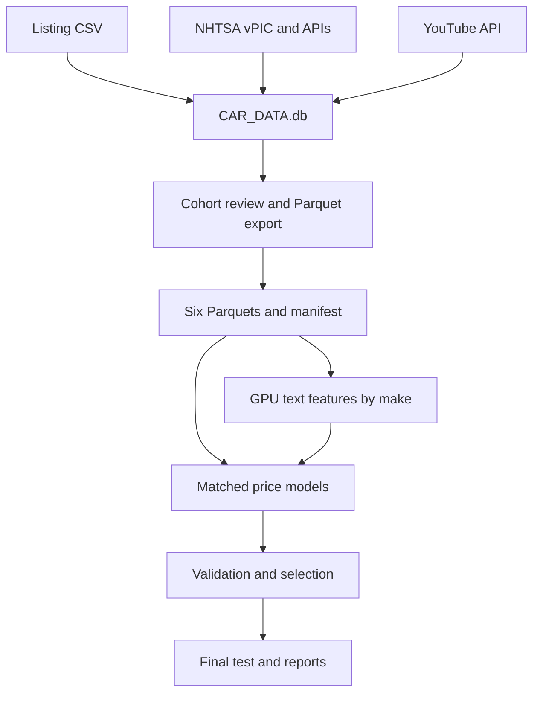

# DataScience Capstone Cars

Car price modeling with listing attributes, NHTSA data, and experimental YouTube text features.

- Collect sources in SQLite and export six Parquet tables for EDA and modeling.
- Compare listing-only, NHTSA-enriched, and text feature sets on matching splits.
- Keep DougScore as a separate expert reference pending identity and date validation.

## Project files

| Path | Purpose |
| --- | --- |
| `DATA/` | Local CSV, vPIC backup, `CAR_DATA.db`, and `CAR_DATA_FINAL/` Parquet snapshot. |
| `NHTSA/` | Listing import, VIN decoding, API collection, and text-feature comparisons. |
| `YOUTUBE/` | Comment collection, GPU text pipeline, and preserved sentiment experiments. |
| `EXPERT_REVIEWS/` | DougScore import, audit, and vehicle-match candidates. |
| `EDA/` | Cleaning, export, dictionary profiling, and `EDA.ipynb`. |
| `MODELS/` | Price training and data diagnostics. |
| `MODEL_OUTPUT/`, `MODEL_OUTPUT.ipynb` | Saved runs and results review. |
| [DATA_DICTIONARY.md](DATA_DICTIONARY.md) | Source schemas, profiles, and derived model fields. |
| [AGENTS.md](AGENTS.md) | Project working standards. |

## Sources

| Source | Local input / collection |
| --- | --- |
| [Kaggle US Used Cars](https://www.kaggle.com/datasets/ananaymital/us-used-cars-dataset) | Save as `DATA/used_cars_data.csv`. |
| [NHTSA vPIC](https://vpic.nhtsa.dot.gov/Downloads) | Restore `DATA/vPICList_lite_2026_09.bak` to SQL Server as `vPICList_Lite`; decode locally. |
| [NHTSA APIs](https://api.nhtsa.gov/) | Collect recalls, complaints, and safety ratings by year/make/model. |
| [YouTube Data API](https://developers.google.com/youtube/v3) | Collect video metadata and top-level comments. |
| [DougScore](https://www.dougdemuro.com/dougscore) | Import the supplied CSV as a separate expert snapshot. |

## Workflow

<!-- mermaid:id=car_workflow -->


## Setup and collection

Run commands from the project root. Large datasets and model artifacts remain local and are ignored by Git.

```powershell
python -m venv .venv
.\.venv\Scripts\python.exe -m pip install -r requirements.txt
.\.venv\Scripts\python.exe NHTSA/build_car_data_db.py --load-only
```

Local VIN decoding requires SQL Server 2019+ and the Microsoft ODBC Driver. With SQL Server running, restore the backup from an Administrator PowerShell session:

```powershell
& 'C:\Program Files\Microsoft SQL Server\Client SDK\ODBC\170\Tools\Binn\SQLCMD.EXE' -S localhost -E -b -i NHTSA\restore_vpic_database.sql
.\.venv\Scripts\python.exe NHTSA/build_car_data_db.py --only vpic
```

- The restore script creates the database only if absent. Adjust its backup path or use `--vpic-server` / `--vpic-database` for another instance.
- Remote collections are explicit: `--only recalls`, `--only complaints`, or `--only safety`; `--only all` includes local vPIC decoding. Add `--load-listings` to refresh the CSV; use `--limit 100` for a trial.
- YouTube collection requires `YOUTUBE_API_KEY` or `GOOGLE_API_KEY` in the environment or root `.env`. Fetch state supports resuming interrupted collection; API requests consume quota.

```powershell
.\.venv\Scripts\python.exe YOUTUBE/YOUTUBE_COMMENTS_API.py
```

Use `YOUTUBE/import_youtube_comments.py` to import a previously collected SQLite table instead. Both collectors default to `DATA/CAR_DATA.db`; use `--help` for paths and options.

## Export and EDA

```powershell
.\.venv\Scripts\python.exe -m MODELS.cohort_price_mileage_review --scope all
.\.venv\Scripts\python.exe EDA/DATA_CLEANING.py
.\.venv\Scripts\python.exe EDA/profile_data_dictionary.py
.\.venv\Scripts\python.exe -m jupyter lab EDA/EDA.ipynb
```

- Cohort review supplies the candidate CSV used by export exclusions; the review itself leaves data unchanged.
- Export converts types, expands complaint/recall JSON, pivots safety ratings, and applies mileage/cohort exclusions. It replaces the Parquet snapshot after validation and leaves SQLite unchanged.
- The manifest records schemas, counts, conversions, and exclusions. The profiler refreshes dictionary statistics; update field definitions before profiling a schema change.
- Run `python -m MODELS.price_data_diagnostics` in `.venv` for read-only checks of keys, missingness, VIN linkage, and date risks.

## YouTube GPU text features

`YOUTUBE/text_pipeline.py` prepares protected video splits, scores pretrained teachers, trains content/sentiment students, scores source comments, and aggregates dated make features. See the [GPU runbook](YOUTUBE/docs/GPU_TEXT_RUNBOOK.md) for commands and settings.

```powershell
python -m venv .venv-youtube
.\.venv-youtube\Scripts\python.exe -m pip install torch==2.7.1 --index-url https://download.pytorch.org/whl/cu126
.\.venv-youtube\Scripts\python.exe -m pip install -r YOUTUBE/requirements-gpu.txt
.\.venv-youtube\Scripts\python.exe YOUTUBE/text_pipeline.py doctor
```

- Saved artifacts: `YOUTUBE/outputs/text_models_v3/`, `text_scored_v1/`, and `text_features_v1/`. Full-source scoring covers 1,287,155 comments; the cutoff is `2026-10-01`.
- `price_features_v1/` selects one explicit-comment, cumulative row per make: 83 makes, 73 with semantic/topic support, and 46 candidate fields.
- Current sentiment has no variable directional signal; independent automotive accuracy remains unmeasured. Features support retrospective comparisons.
- Use fresh output directories. `score` and `train` resume with identical arguments plus `--resume`; `prepare` and `aggregate` require new directories.

Preserved alternatives: [sentiment design](YOUTUBE/docs/EXPERIMENTAL_SENTIMENT_FEATURE_PLAN.md), [relevance runbook](YOUTUBE/docs/RELEVANCE_ROUND_RUNBOOK.md), and [DougScore integration](EXPERT_REVIEWS/DOUGSCORE_INTEGRATION_PLAN.md). DougScore contains 585 reviews; approved vehicle matches and score-availability dates remain pending.

## Listing-price models

`MODELS/Price_ML_Models.py` fits `ln(price)` and reports predictions/errors in USD for new and used advertised listings.

- `base`: listing predictors and deterministic derived fields.
- `enriched`: base plus vPIC, complaint/recall aggregates, and safety ratings. YouTube features enter the separate text comparison below.
- Default splits hold out year/make/model families, keeping trims together. `known_family` holds out VINs instead. Preprocessing uses training rows; validation selects settings before final refitting and test evaluation.

```powershell
.\.venv\Scripts\python.exe -m MODELS.Price_ML_Models --model-types base enriched --models catboost --sample-size 100000 --tuning-rows 50000 --max-trees 6400 --shap-rows 0 --split-strategy unseen_family
.\.venv\Scripts\python.exe -m jupyter lab MODEL_OUTPUT.ipynb
```

Use `--sample-size 0 --tuning-rows 100000` for all eligible listings. Final fitting runs in memory. Omitting `--models` runs eight estimators; `--price-weightings none high_price` compares ordinary and capped price weights.

Saved runs include metrics, segment/year/make reports, split receipts, predictions, tuning diagnostics, metadata, and fitted `predictor.joblib` files. The notebook pairs compatible runs; `predict_listings()` scores new rows without a price label.

## NHTSA and YouTube feature comparison

`NHTSA/text_features.py` freezes eligible listings and matching splits, builds automatic family features, and compares these additions:

| Feature set | Inputs |
| --- | --- |
| `base` | Listing predictors. |
| `enriched` / `nhtsa_structured` | Base plus vPIC and structured NHTSA inputs. |
| `nhtsa_text` | Enriched plus source components/support and separate complaint, defect, consequence, and remedy vectors. |
| `nhtsa_text_youtube` | NHTSA text plus the selected make-level YouTube fields. |
| `nhtsa_text_youtube_coverage`, `nhtsa_text_youtube_topics` | Coverage-only and coverage plus semantic/topic comparisons. |

Start a new full validation run, including the coverage comparisons:

```powershell
.\.venv\Scripts\python.exe -m NHTSA.text_features run-full --sample-size 0 --coverage-ablations
```

Defaults: eight estimators, both price-weighting treatments, 100,000 tuning rows per partition, 6,400 maximum boosting trees, and 16 vector dimensions per channel. The automatic route requires no manual labels. Existing workspaces are preserved.

Review validation and convergence before final testing. Use the printed workspace and the same settings to refit selected candidates and score the test once:

```powershell
.\.venv\Scripts\python.exe -m NHTSA.text_features compare --workspace '<printed-workspace>' --build-name features_automatic --representation tfidf --feature-sets base enriched nhtsa_text nhtsa_text_youtube nhtsa_text_youtube_coverage nhtsa_text_youtube_topics --models catboost lightgbm xgboost random_forest multiple_linear_regression lasso ridge elastic_net --price-weightings none high_price --tuning-rows 100000 --max-trees 6400 --vector-dimensions 16 --vector-training-documents 100000 --youtube-features YOUTUBE/outputs/price_features_v1 --evaluate-test
```

Reports cover overall errors, every make, $25,000 price bands, the `100k+` tier, matched feature/weighting changes, and YouTube join support. No evaluation rows means null errors. Do not tune from exposed test results.

## Data conventions

- Cohort = separate vPIC `ModelYear`, `Make`, `Model`, and `Trim` columns. Join listings using lowercase `vin`; capitalized `VIN` is a decoder variable.
- Missing measurements remain null; absent records do not establish zero defects or neutral sentiment. Make-level YouTube features are not cohort-level observations.
- Historical listings end in September 2020. The provisional NHTSA cutoff is `2020-12-31`; YouTube features use a 2026 cutoff. Enriched results describe retrospective associations; historical price/text availability remains unverified.
