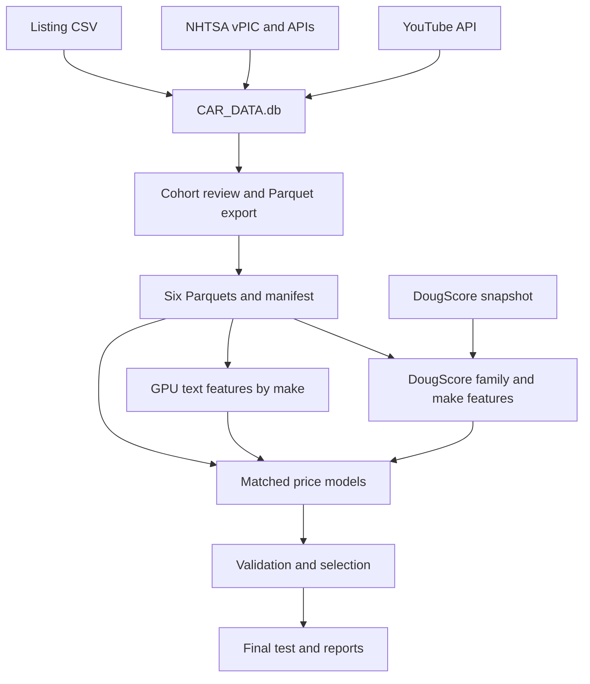
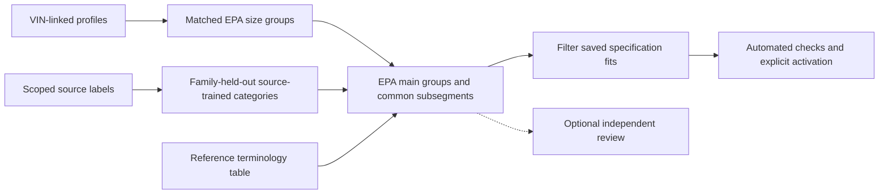
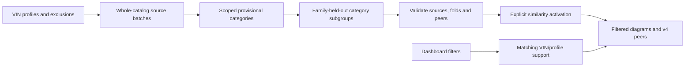
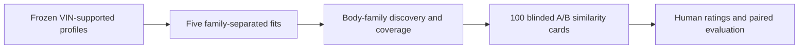
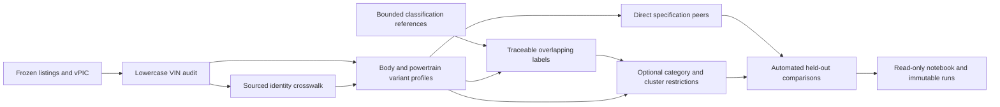
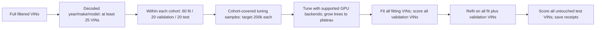
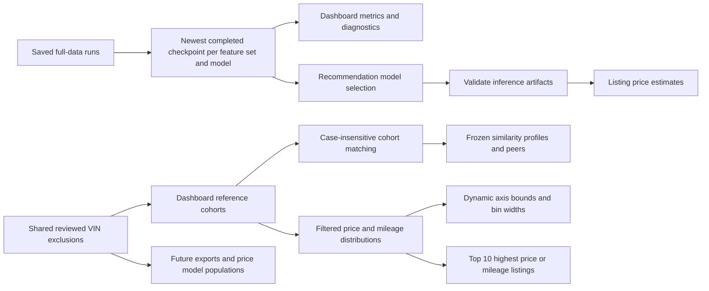
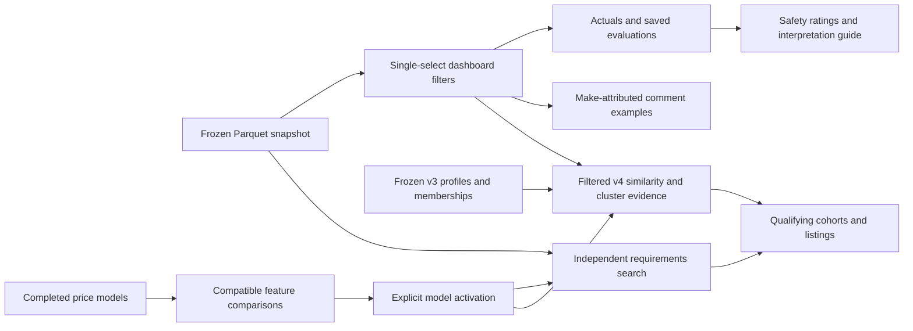
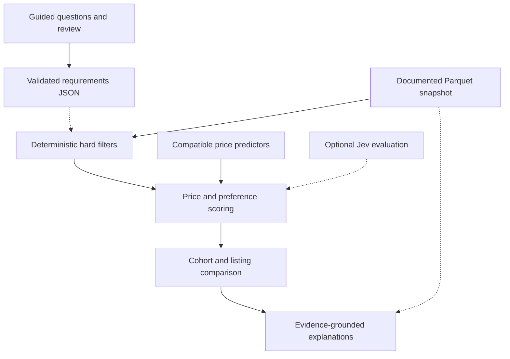

# DataScience Capstone Cars

Car price modeling with listing attributes, NHTSA data, and experimental YouTube text features.

- Collect sources in SQLite and export six Parquet tables for EDA and modeling.
- Compare listing-only, NHTSA-enriched, and text feature sets on matching splits.
- Add separate DougScore expert predictors using automatic year/make/model matches and supported make averages; timing remains retrospective.

## Project files

| Path | Purpose |
| --- | --- |
| `DATA/` | Local CSV, vPIC backup, `CAR_DATA.db`, and `CAR_DATA_FINAL/` Parquet snapshot. |
| `NHTSA/` | Listing import, VIN decoding, API collection, and text-feature comparisons. |
| `YOUTUBE/` | Comment collection, GPU text pipeline, and preserved sentiment experiments. |
| `EXPERT_REVIEWS/` | DougScore import, automatic family/make features, and linkage audit. |
| `EDA/` | Cleaning, export, dictionary profiling, and `EDA.ipynb`. |
| `MODELS/` | Price training, data diagnostics, and the recommendation design. |
| `app.py`, `app_pages/`, `car_app/` | Local Streamlit dashboard and guided recommendation question drafts. |
| `requirements-app.txt`, `.streamlit/` | Dashboard dependencies and loopback-only configuration. |
| `MODEL_OUTPUT/`, `MODEL_OUTPUT.ipynb` | Saved runs and results review. |
| [DATA_DICTIONARY.md](DATA_DICTIONARY.md) | Source schemas, profiles, and derived model fields. |
| [AGENTS.md](AGENTS.md) | Project working standards. |

## Sources

| Source | Local input / collection |
| --- | --- |
| [Kaggle US Used Cars](https://www.kaggle.com/datasets/ananaymital/us-used-cars-dataset) | Save as `DATA/used_cars_data.csv`. |
| [NHTSA vPIC](https://vpic.nhtsa.dot.gov/Downloads) | Restore `DATA/vPICList_lite_2026_09.bak` to SQL Server as `vPICList_Lite`; decode locally. |
| [NHTSA APIs](https://api.nhtsa.gov/) | Collect recalls, complaints, and safety ratings by year/make/model. |
| [YouTube Data API](https://developers.google.com/youtube/v3) | Collect video metadata and top-level comments. |
| [DougScore](https://www.dougdemuro.com/dougscore) | Import the supplied CSV as a separate expert snapshot. |

## Workflow

<!-- mermaid:id=car_workflow -->


## Setup and collection

Run commands from the project root. Large datasets and model artifacts remain local and are ignored by Git.

```powershell
python -m venv .venv
.\.venv\Scripts\python.exe -m pip install -r requirements.txt
.\.venv\Scripts\python.exe NHTSA/build_car_data_db.py --load-only
```

Local VIN decoding requires SQL Server 2019+ and the Microsoft ODBC Driver. With SQL Server running, restore the backup from an Administrator PowerShell session:

```powershell
& 'C:\Program Files\Microsoft SQL Server\Client SDK\ODBC\170\Tools\Binn\SQLCMD.EXE' -S localhost -E -b -i NHTSA\restore_vpic_database.sql
.\.venv\Scripts\python.exe NHTSA/build_car_data_db.py --only vpic
```

- The restore script creates the database only if absent. Adjust its backup path or use `--vpic-server` / `--vpic-database` for another instance.
- Remote collections are explicit: `--only recalls`, `--only complaints`, or `--only safety`; `--only all` includes local vPIC decoding. Add `--load-listings` to refresh the CSV; use `--limit 100` for a trial.
- YouTube collection requires `YOUTUBE_API_KEY` or `GOOGLE_API_KEY` in the environment or root `.env`. Fetch state supports resuming interrupted collection; API requests consume quota.

```powershell
.\.venv\Scripts\python.exe YOUTUBE/YOUTUBE_COMMENTS_API.py
```

Use `YOUTUBE/import_youtube_comments.py` to import a previously collected SQLite table instead. Both collectors default to `DATA/CAR_DATA.db`; use `--help` for paths and options.

## Export and EDA

```powershell
.\.venv\Scripts\python.exe -m MODELS.cohort_price_mileage_review --scope all
.\.venv\Scripts\python.exe EDA/DATA_CLEANING.py
.\.venv\Scripts\python.exe EDA/profile_data_dictionary.py
.\.venv\Scripts\python.exe -m jupyter lab EDA/EDA.ipynb
```

- Cohort review supplies the candidate CSV used by export exclusions; the review itself leaves data unchanged.
- Export converts types, expands complaint/recall JSON, pivots safety ratings, and applies mileage/cohort exclusions. It replaces the Parquet snapshot after validation and leaves SQLite unchanged.
- Manual listing exclusions are shared by export, future price-model fitting/evaluation populations, and dashboard listing queries (including recommendations and distribution extremes). Excluded VINs: JN1BJ1CV7LW262847, 123686, WBAGK2324TDH67073, 3C7WRSAL3KG618855, 1FTEW1CP3LFC54483, 1FTEW1E4XLKE38250. Dashboard row-level evaluation also omits these VINs. Existing fitted models and saved overall metrics remain historical; removing their training influence requires a new training run. Raw SQLite and the existing frozen Parquet snapshot remain unchanged; future exports apply the exclusions.
- The manifest records schemas, counts, conversions, and exclusions. The profiler refreshes dictionary statistics; update field definitions before profiling a schema change.
- Run `python -m MODELS.price_data_diagnostics` in `.venv` for read-only checks of keys, missingness, VIN linkage, and date risks.

## YouTube GPU text features

`YOUTUBE/text_pipeline.py` prepares protected video splits, scores pretrained teachers, trains content/sentiment students, scores source comments, and aggregates dated make features. See the [GPU runbook](YOUTUBE/docs/GPU_TEXT_RUNBOOK.md) for commands and settings.

```powershell
python -m venv .venv-youtube
.\.venv-youtube\Scripts\python.exe -m pip install torch==2.7.1 --index-url https://download.pytorch.org/whl/cu126
.\.venv-youtube\Scripts\python.exe -m pip install -r YOUTUBE/requirements-gpu.txt
.\.venv-youtube\Scripts\python.exe YOUTUBE/text_pipeline.py doctor
```

- Saved artifacts: `YOUTUBE/outputs/text_models_v3/`, `text_scored_v1/`, and `text_features_v1/`. Full-source scoring covers 1,287,155 comments; the cutoff is `2026-10-01`.
- `price_features_v1/` selects one explicit-comment, cumulative row per make: 83 makes, 73 with semantic/topic support, and 46 candidate fields.
- Current sentiment has no variable directional signal; independent automotive accuracy remains unmeasured. Features support retrospective comparisons.
- Use fresh output directories. `score` and `train` resume with identical arguments plus `--resume`; `prepare` and `aggregate` require new directories.

Preserved alternatives: [sentiment design](YOUTUBE/docs/EXPERIMENTAL_SENTIMENT_FEATURE_PLAN.md), [relevance runbook](YOUTUBE/docs/RELEVANCE_ROUND_RUNBOOK.md), and [DougScore integration](EXPERT_REVIEWS/DOUGSCORE_INTEGRATION_PLAN.md). DougScore contains 585 reviews; automatic family linkage is available, while manual/video verification and historical score dates remain pending.

## Vehicle evidence and discovery v5

`MODELS/vehicle_similarity_v5.py` adds separate trim-level cohort and model-level discovery. It reads the selected Parquet snapshot without changing price training. Model-level profiles include missing-trim vehicles; the two populations have separate memberships, counts, fits, and evaluations.

**EPA-first discovery:** `MODELS/vehicle_category_hierarchy.py` builds an independently saved classification layer over the completed fits. EPA size classes are the main display groups, with drivetrain suffixes combined only when compatible EPA variants agree on the size class. Common market terms are subsegments; economy, mainstream, premium, luxury and ultra-luxury remain separate positioning attributes. The supplied [classification table](https://en.wikipedia.org/wiki/Car_classification#Summary_of_classifications), [EPA directory](https://www.fueleconomy.gov/feg/byclass/byEPAclassNF.shtml), and [NHTSA size reference](https://en.wikipedia.org/wiki/Vehicle_size_class#NHTSA) retain separate meanings. Illustrative model examples have unverified year scope and are labeled accordingly; they never establish EPA classes.

Source-trained models fill unknown EPA groups, market sizes and positioning at probability >=0.70 with at least three training families per class. Each query's entire family fold is excluded from fitting and model selection. Development-family macro F1 selects logistic regression without make or an ExtraTrees ensemble with make. Each emitted label also requires >=80% source agreement across at least three development emitted-label families. Deployment then requires >=80% agreement across at least ten outer held-out emitted-label families for the class; weaker labels stay inactive. These held-out results govern deployment and are not an untouched estimate after promotion. Held-out source agreement is reported per class/fold; it is not independently reviewed accuracy, and probabilities are uncalibrated. Unknown performance labels are not converted into negatives. Human category review and peer review are optional and do not block this classification layer. Recorded labels take precedence. Strict recommendation filters continue to exclude predictions. The dashboard defaults to EPA groups, offers common-subsegment filters, and shows the existing specification fits within the selected population.

Build into a fresh directory, then activate after the built-in artifact, membership and family-separation checks:

```powershell
& .\.venv\Scripts\python.exe -m MODELS.vehicle_category_hierarchy --run MODEL_OUTPUT/vehicle_similarity_v5/20261026-repair/run-reconciled --sources MODEL_OUTPUT/vehicle_similarity_v5/20261026-repair/sources-reconciled --output MODEL_OUTPUT/vehicle_similarity_v5/20261026-epa-hierarchy-supported --activate
```

Activation creates an immutable `-validated` layer after the outer-family deployment check, adds its checksummed pointer to the registry, and saves the previous registry contents. The completed specification fits and peer rankings are reused. The historical stage commands below remain available for rebuilding the underlying discovery bundle; their independent-review route is optional.

The active `20261026-epa-hierarchy-supported-validated` layer has 18 EPA main groups and 19 cohort / 21 model common-subsegment terms. Recorded plus deployed predicted EPA groups cover 1,896,291 cohort listings and 2,349,314 model listings, separately out of 2,792,993. It activates 499 cohort EPA predictions, 432 model EPA predictions and 5,847 model positioning predictions. Learned size labels failed deployment support and remain inactive. These are profile-level prediction counts and overlapping discovery populations, not independent vehicles to add together.



- Reconcile drivetrain specificity, seating and propulsion evidence. Gasoline/diesel with missing electrification is **combustion fuel observed; electrification unverified**. Preserve source disagreements and numerical bounds. Generic hybrid evidence retains an unverified plug-in state until explicit decoder/EPA evidence resolves it. EPA regulatory classes remain separate from market terminology. NHTSA NCAP classes are separately derived from observed body and supported curb-weight bounds, using the [official NHTSA definitions](https://www.nhtsa.gov/ratings). Passenger-car assignments require five weights, at least 90% VIN coverage, and no weight-band crossing; GVWR is not substituted for curb weight. The supplied [vehicle-size reference](https://en.wikipedia.org/wiki/Vehicle_size_class#NHTSA) and [EPA year/class directory](https://www.fueleconomy.gov/feg/byclass/byepaclassnf.shtml) are retained in classification provenance.
- Listing displacement in cc is reconciled with vPIC `DisplacementCC`. Missing values can use the decoder; differences exceeding 5% or 50 cc remain conflicting. Raw values and source counts are retained. Width and reconciled displacement are clustering candidates subject to development-only coverage and redundancy checks. Horsepower and wheelbase retain decoder bounds and disagreement counts.
- Wikimedia requests are serial, paced, cached, and retried with `Retry-After` support. Deferred requests remain in the inventory. Completed collection receipts can contain explicit pending families; start a fresh stage with `--reuse-sources` to recover them. Successful cached responses can be reparsed without downloading them again. `--offline` imports verified successes and records pending references without network access.
- The optional independent-review classifier compares logistic regression and CPU CatBoost, including a make ablation. Its conservative and broader policies retain their reviewed precision/support gates. The EPA-first source-trained layer above uses a separate experimental policy and does not claim those reviewed precision targets.
- Five family folds isolate queries from preprocessing, classifier selection/calibration, and cluster fitting. Clusters retain support/stability gates, use family-balanced fitting, and reject assignments beyond development-derived radii. Category and cluster adjustments are bounded at 0.10 each; direct specification peers remain the default until a completed blinded comparison passes promotion gates.
- Streamlit reads saved artifacts only. Choose cohort or model-level discovery explicitly. Saved subgroup colors are the default; category evidence and prediction probabilities are separate. Strict category filters accept observed/source-supported evidence only. EPA/NCAP classes and reconciled drivetrain categories are profile inspection views; individual drivetrain must-haves continue to use listing filters.

Run from the project root in one PowerShell session. Use fresh output directories; completed stages are immutable. Full clustering can take substantial time on CPU.

```powershell
$PythonExe = '.\.venv\Scripts\python.exe'
$RunRoot = 'MODEL_OUTPUT/vehicle_similarity_v5/' + (Get-Date -Format 'yyyyMMddTHHmmss')
& $PythonExe -m MODELS.vehicle_similarity_v5 prepare --data-dir DATA/CAR_DATA_FINAL --output "$RunRoot/prepared"
& $PythonExe -m MODELS.vehicle_similarity_v5 collect-sources --prepared "$RunRoot/prepared" --reuse-sources MODEL_OUTPUT/vehicle_similarity_v4/20261025T224304/sources --limit 2 --output "$RunRoot/pilot"
& $PythonExe -m MODELS.vehicle_similarity_v5 collect-sources --prepared "$RunRoot/prepared" --reuse-sources "$RunRoot/pilot" --output "$RunRoot/sources"
& $PythonExe -m MODELS.vehicle_similarity_v5 build-categories --prepared "$RunRoot/prepared" --sources "$RunRoot/sources" --output "$RunRoot/categories"
& $PythonExe -m MODELS.vehicle_similarity_v5 analyze --prepared "$RunRoot/prepared" --categories "$RunRoot/categories" --smoke --output "$RunRoot/smoke"
& $PythonExe -m MODELS.vehicle_similarity_v5 analyze --prepared "$RunRoot/prepared" --categories "$RunRoot/categories" --output "$RunRoot/run"
& $PythonExe -m MODELS.vehicle_similarity_v5 validate --run "$RunRoot/run" --output "$RunRoot/validation"
& $PythonExe -m MODELS.vehicle_similarity_v5 activate --run "$RunRoot/run" --validation "$RunRoot/validation"
```

Check `$LASTEXITCODE` after each command and stop on failure. `--resume` requires identical inputs, configuration and code and refuses completed stages. Analysis reuses verified cluster checkpoints; other interrupted stages recompute deterministic work in the uncompleted directory. Collection recovery uses a fresh output plus `--reuse-sources`; it preserves request history and cooldowns. Scoped terminal classification outcomes are reused only with the same family/year/title scope and parser version; request failures remain retryable. Bump the parser version when changing Wikipedia parsing or identity matching. Source `pending_families`, coverage tables and exceptions distinguish transport recovery from successful classification.

Optional independent category review HTML cards link evidence; export them with `export-review` if needed. Fill `reviewer`, `verdict` (`accept`, `correct`, `unknown`), corrected semicolon-separated `labels`, and `reviewed_all=true` only for explicitly reviewed performance negatives. Conflicting judgments require one row with a named `adjudicator`. Preserve existing inventories.

```powershell
& $PythonExe -m MODELS.vehicle_similarity_v5 import-review --categories "$RunRoot/categories" --review "$RunRoot/category-review" --ratings <completed-category-ratings.csv> --output "$RunRoot/reviewed-labels"
& $PythonExe -m MODELS.vehicle_similarity_v5 train-classifiers --categories "$RunRoot/categories" --review "$RunRoot/reviewed-labels" --output "$RunRoot/classifiers-reviewed"
```

For the optional reviewed-classifier route, re-run analysis into a fresh directory to incorporate validated predictions. Without reviewed calibration/test support, that route records a pending/inactive result. The separately activated source-trained classification layer does not require this route.

Optional peer evaluation freezes up to 100 distinct families per grain before fitting. Existing review exports are retained for later use; this workflow does not require completing them. If evaluating peer-ranking usefulness later, place ratings under `<ratings-directory>/cohort/ratings.csv` and `<ratings-directory>/model/ratings.csv`. Keep `blind_key.csv` separate until review ends.

```powershell
& $PythonExe -m MODELS.vehicle_similarity_v5 evaluate-peer-review --run "$RunRoot/run" --validation "$RunRoot/validation" --review "$RunRoot/peer-review" --ratings <ratings-directory> --output "$RunRoot/peer-evaluation"
& $PythonExe -m MODELS.vehicle_similarity_v5 activate --run "$RunRoot/run" --validation "$RunRoot/validation" --evaluation "$RunRoot/peer-evaluation"
```

Optional peer-ranking promotion retains its 100-family and useful@5 gates. Category-layer activation requires completed matching artifacts and automated checks, with no human or peer-review prerequisite. Existing v3/v4 bundles remain readable.

Local repair audit `20261026-repair/run-reconciled` passed full replay validation for both grains. The 1,115-family collection recovered scoped claims for 116 of the 604 formerly unavailable families; eight request rejections remain explicit. Reconciliation filled 138,572 missing displacement values from vPIC and retained 175,128 disagreeing pairs as conflicts.

| Listing coverage | v4 cohort | v5 cohort | v5 model |
|---|---:|---:|---:|
| Retained listings | 2,792,993 | 2,792,993 | 2,792,993 |
| Source-supported market size segment | 690,340 | 811,829 | 905,476 |
| Direct specification peers available | 2,150,203 | 2,096,613 | 2,426,927 |

Grains overlap; never add these counts. Under v5 definitions, cohort peer availability is 53,590 listings lower. Model-level discovery supports peers for 363,934 missing-trim listings. These are availability counts; buyer usefulness remains ungraded. The checksummed `comparison-reconciled-final` and `rollout-audit` directories preserve field support, accepted fits, assignment rejection, and VIN-level gains/losses. Category review has 111 batches; blinded peer review has 100 families per grain. The active registry now selects `vehicle_similarity_v5/20261026-repair/run-reconciled`, with direct specification peers as the default for both grains. Human review was explicitly deferred for this base-bundle activation on 2026-10-26. Independently reviewed predictions remain pending; the separate EPA-first layer supplies experimental source-trained predictions without requiring those reviews. `activation-bba804859ff94d5da8380a229f348edc` preserves the previous registry and activation receipt. Streamlit's Vehicle categories view identifies v5, offers both discovery populations, and resets diagram colors to saved subgroups when switching bundles. Price-model settings are preserved.

## Vehicle categories and category-aware clustering (v4)

The opt-in v4 workflow assigns provisional, evidence-backed economy/luxury/performance categories before fitting specification subgroups. Market positioning, performance, size, body and powertrain remain separate dimensions. Labels may overlap. Unknown, conflicting, unavailable and out-of-scope evidence remain explicit; source coverage is not classification accuracy.

<!-- mermaid:id=vehicle_categories_v4 -->


- Preparation reads the existing Parquets, joins on lowercase `vin`, applies shared manual exclusions before aggregation, and retains one membership per listing. Source Parquets and price training remain unchanged.
- Collection attempts every complete vehicle family in batches of 100 with two workers. Curated manufacturer/model evidence retains its original scope; structured references require exact identity and explicit model years. Search results only discover candidate pages. Cached responses and committed family outcomes support resume. Failed or ambiguous references remain unresolved; not every vehicle will receive a category. No hosted AI or category classifier runs.
- Categories retain source URL, excerpt, applicable scope, mapping ID and provisional status. `category_coverage.csv` reports profiles, distinct families and listings by dimension/reason; overlapping counts are not additive. `category_coverage.parquet` and `exceptions.csv` retain unresolved details.
- Discovery compares global/body-family views with category × body-family views using five family folds. Full runs screen 2–8 groups with five refits and confirm finalists with 30. Views require 50 eligible training profiles and 20 families; clusters require five families and the existing size floor, positive silhouette, median ARI >=0.70, lower-decile ARI >=0.60, and family-balanced sensitivity >=0.70. Small categories remain visible without a supported subdivision. Names and examples use development members only.
- Direct peers remain the research baseline. The v4 reference-similarity panel defaults to saved `category_cluster` results, with `category_specs` and `direct_specs` available for comparison. Category/cluster usefulness remains experimental. Independent recommendation preferences rank by matched dimensions (OR within each dimension), with the existing sort as the tie-breaker. Strict mode requires every selected dimension and excludes unknowns. Match fractions are not confidence scores.
- Streamlit reads completed bundles only. **Dashboard → Vehicle categories** and the recommendation page show category counts, subgroup composition and observed-coordinate diagrams from the active v4 bundle. All sidebar filters restrict listing VINs before profile matching; local category selections further restrict the diagrams. Counts describe matching listings, while coordinates and assignments remain frozen. Color by category or saved subgroup; unsupported assignments stay explicit. Diagram cluster IDs share one fitted fold/view/method. Plotting samples above 3,000 profiles; coverage and tables use complete matching populations.
- Reference choices include all matching complete variants without a 200-cohort cap. Selecting sidebar filters chooses the most-supported reference by default and refreshes saved similarity results automatically. References, their observed-price summaries and example listings follow the filters; alternatives search the broader catalog under the selected saved method. Source/artifact/filter/method changes invalidate affected results, while the independent question draft remains separate. Activation updates only similarity settings, preserving price settings; v3 runs retain direct similarity.

Run each block in the same PowerShell session. These commands have not been launched on the catalog as part of this change. Choose when to run the expensive fit alongside other local work.

```powershell
Set-Location E:\DataScience_Capstone_Cars
$PythonExe = 'E:\DataScience_Capstone_Cars\.venv\Scripts\python.exe'
$RunRoot = Join-Path 'E:\DataScience_Capstone_Cars\MODEL_OUTPUT\vehicle_similarity_v4' (Get-Date -Format 'yyyyMMddTHHmmss')

& $PythonExe -m MODELS.vehicle_similarity_v4 prepare --data-dir 'E:\DataScience_Capstone_Cars\DATA\CAR_DATA_FINAL' --output "$RunRoot\prepared"
if ($LASTEXITCODE -ne 0) { throw 'Preparation failed.' }
& $PythonExe -m MODELS.vehicle_similarity_v4 collect-sources --prepared "$RunRoot\prepared" --all-families --batch-size 100 --workers 2 --output "$RunRoot\sources"
if ($LASTEXITCODE -ne 0) { throw 'Source collection failed or was interrupted.' }
& $PythonExe -m MODELS.vehicle_similarity_v4 build-categories --prepared "$RunRoot\prepared" --sources "$RunRoot\sources" --output "$RunRoot\categories"
if ($LASTEXITCODE -ne 0) { throw 'Category checks failed.' }
Import-Csv "$RunRoot\categories\category_coverage.csv" | Format-Table
```

Inspect coverage and exceptions, then run checks and fitting:

```powershell
& $PythonExe -m unittest MODELS.test_vehicle_profiles car_app.test_dashboard
if ($LASTEXITCODE -ne 0) { throw 'Regression checks failed.' }
& $PythonExe -m MODELS.vehicle_similarity_v4 analyze --prepared "$RunRoot\prepared" --categories "$RunRoot\categories" --smoke --threads 1 --output "$RunRoot\smoke"
if ($LASTEXITCODE -ne 0) { throw 'Smoke run failed.' }
& $PythonExe -m MODELS.vehicle_similarity_v4 analyze --prepared "$RunRoot\prepared" --categories "$RunRoot\categories" --threads 1 --output "$RunRoot\run"
if ($LASTEXITCODE -ne 0) { throw 'Full clustering failed or was interrupted.' }
```

Repeat an interrupted `collect-sources` or `analyze` command with `--resume` and identical arguments. Completed outputs are immutable. Resume checks input/code/configuration identity and reuses verified completed view checkpoints; an unfinished view is retried in a separate attempt directory. In a new PowerShell session, set `$RunRoot` to the existing directory instead of generating a new timestamp.

The empty-peer category-ranking fix also supports resuming the original v4 release. It requires identical inputs, dependencies, package versions and fitting-function fingerprints, preserves the original checkpoint contracts, and records `resume_compatibility.json`. It does not rerun preparation, source collection or completed fits. Other code/configuration changes still require a fresh run.

Validation compares profile IDs and integer cluster values, allowing the int32/int64 promotion caused by combining estimators. The validator-only repair accepts the known previous analysis release only when analysis/fitting/ranking fingerprints and all other execution dependencies match; the validation report records that compatibility. Completed analysis artifacts remain unchanged. After a failed validation, rerun `validate` with a fresh output directory (for example, `validation-fixed`), then pass that directory to `activate`; clustering does not need to be repeated.

```powershell
& $PythonExe -m MODELS.vehicle_similarity_v4 validate --run "$RunRoot\run" --output "$RunRoot\validation"
if ($LASTEXITCODE -ne 0) { throw 'Validation failed; activation stopped.' }
& $PythonExe -m MODELS.vehicle_similarity_v4 activate --run "$RunRoot\run" --validation "$RunRoot\validation"
if ($LASTEXITCODE -ne 0) { throw 'Activation failed.' }
& $PythonExe -m streamlit run 'E:\DataScience_Capstone_Cars\app.py' --server.address 127.0.0.1
```

Validation reconciles membership, categories, sources and dependencies, checks held-out families/preprocessing, and reproduces peer results without fitting. Smoke runs cannot activate. Activation prints a receipt directory containing the previous similarity pointer for rollback; restore only those two similarity keys if needed, preserving price settings. If Streamlit is already running, refresh its page instead of starting a second server. Artifact changes invalidate affected results and category selections. The notebook reads `VEHICLE_SIMILARITY_V4_RUN_DIR` or the latest completed full v4 run without refitting.

Future price experiment: compare matched baseline models against category features, then category plus cluster features, with training-only feature generation and explicit activation after evaluation. These research outputs are not added to the selected price-model dataset or its dictionary. Category precision, buyer usefulness and classifier training remain unvalidated future work.

## Vehicle discovery and blinded similarity evaluation

`MODELS/vehicle_similarity_v3.py` reads a frozen v2 preparation. It preserves the decoded cohort keys, VIN-supported variants, unknown evidence, and legacy readers. Five family folds fit their own field selection, source-scale checks, preprocessing, and clusters. Source tables and prior runs remain unchanged.

```powershell
.\.venv\Scripts\python.exe -m MODELS.vehicle_similarity_v3 analyze --prepared MODEL_OUTPUT/vehicle_taxonomy_v2/20261023T173930-prepare --output MODEL_OUTPUT/vehicle_similarity_v3/<fresh-analysis>
.\.venv\Scripts\python.exe -m MODELS.vehicle_similarity_v3 export-review --run MODEL_OUTPUT/vehicle_similarity_v3/<fresh-analysis> --output MODEL_OUTPUT/vehicle_similarity_v3/<fresh-review>
.\.venv\Scripts\python.exe -m MODELS.vehicle_similarity_v3 evaluate-review --review MODEL_OUTPUT/vehicle_similarity_v3/<fresh-review> --ratings <completed-ratings.csv> --output MODEL_OUTPUT/vehicle_similarity_v3/<fresh-evaluation>
```

<!-- mermaid:id=vehicle_similarity_v3 -->


- Distance averages observed fields within each block, then gives size and powertrain equal weight. Numerical bounds use development 1st–99th percentiles; min–max scaling remains a sensitivity. Peer pairs still need sufficient shared observations, compatible body/powertrain, distinct families, and explicit year windows.
- Discovery compares K-means, Gower medoids, and average-linkage hierarchy globally and within body families. Source-derived luxury/economy/performance labels do not select the primary discovery population. Screening uses five family refits; finalists use 30. Support requires 50 profiles, 20 families, five families per cluster, median ARI >=0.70, lower-decile ARI >=0.60, positive silhouette, and repeated family-balanced ARI >=0.70. Unsupported subdivisions remain explicit.
- Hierarchical fits preserve reference memberships and use supported nearest medoids for other profiles, abstaining beyond development 95th-percentile radii. Complete-case, missingness, transmission, and scaling comparisons accompany finalists. Silhouettes do not rank different methods; accepted Gower, hierarchy, then K-means is the fixed retrieval precedence.
- `evaluation_queries.csv` freezes 100 distinct families from observed-support candidates before fitting. Each family is held out from its own models. `query_status.parquet` retains every profile/approach, including ineligible and empty results; `coverage.csv` reports actual out-of-fold retrieval availability. Global clusters remain a comparison; only body-family clusters can add the fixed 0.10 soft mismatch penalty.
- Open the exported `review_cards.html`, enter your reviewer name, grade returned vehicles 0/1/2, choose A/B/tie/neither, and export ratings CSV. The browser keeps local progress; the CSV is the durable copy. Review cards omit method names and distances. Keep `blind_key.csv` separate until review is complete; do not edit frozen files. Repeated vehicles within a card must receive the same grade.
- Evaluation counts unavailable positions against useful@5, retains empty queries, and uses two seeded 2,000-draw family bootstrap intervals. Cluster-aware retrieval is adopted only after 100 non-smoke comparisons, positive lower 95% bounds for useful@5 improvement, zero compatibility violations, and no coverage loss. Direct retrieval remains selected while review is pending or inconclusive.
- To use an explicitly incomplete submission, add `--allow-incomplete` to `evaluate-review`. Blank grades exclude that query from both methods' usefulness/strong-match scores; blank preferences are excluded separately. All frozen queries remain in coverage. Missing judgments remain blank, and incomplete reviews cannot adopt clusters.
- Human evaluation `20261024-human-evaluation` uses 98 fully graded pairs and 99 preferences from 100 cards. Direct/cluster useful@5 is 99.39%/99.59%; the paired gain is 0.20 percentage points (95% interval 0–0.61). Four preferences favor clusters and 95 tie. Retain direct retrieval; audit rejected/changed alternatives, strengthen identity/specification evidence, and test a separate market/buyer-fit reranker on fresh challenging cases before dashboard integration.
- `--smoke` reduces fitting and query budgets and cannot establish readiness. `lookup_profiles(run, year, make, model, trim)` returns saved profiles, evidence and peers without refitting. The notebook defaults to the latest completed full-budget v3 run when available; `VEHICLE_SIMILARITY_V3_RUN_DIR` pins it explicitly. No dashboard or hosted AI integration is enabled.

Fuel observations, electrification evidence, and resolved powertrain remain separate. Missing electrification never establishes combustion. Current electric specifications and semantic label accuracy remain unsupported; one reviewer validates only the reviewed catalog population. Family separation follows accepted aliases with decoded Make/Model fallback. Unresolved aliases may still cross blocks, so block intervals do not establish independence of every real market family.

## Interpretable vehicle taxonomy and peers

The notebook now defaults to the v2 variant workflow. It preserves separate decoded cohort keys and the legacy runs below. All retained VINs enter the identity audit; incomplete identities remain audit-only. Known body/powertrain variants have subordinate profiles, while conflicting and unknown evidence remain explicit.

```powershell
.\.venv\Scripts\python.exe -m MODELS.vehicle_taxonomy_v2 prepare --research-run MODEL_OUTPUT/vehicle_profiles/20261022T220141-segmentation-final --output MODEL_OUTPUT/vehicle_taxonomy_v2/<fresh-preparation>
.\.venv\Scripts\python.exe -m MODELS.vehicle_taxonomy_sources --prepared MODEL_OUTPUT/vehicle_taxonomy_v2/<fresh-preparation> --output MODEL_OUTPUT/vehicle_taxonomy_v2/<fresh-reference-batch>
.\.venv\Scripts\python.exe -m MODELS.vehicle_taxonomy_v2 analyze --prepared MODEL_OUTPUT/vehicle_taxonomy_v2/<fresh-preparation> --output MODEL_OUTPUT/vehicle_taxonomy_v2/<fresh-analysis>
```

- `taxonomy/identity_crosswalk.v2.json` retains exact decoded-to-market-family evidence, year/body/trim scope and original names. Manufacturer references resolve documented BMW 2012 3-Series and 2011 5-Series identities. Family split blocks connect these aliases across years without extending semantic assignments beyond documented years.
- `vehicle_taxonomy_sources` checks a bounded 200-family discovery batch. Exact-title matches and explicit source model-year scope are required for automatic candidates. Acquisition results are not automatically promoted: accepted entries live in `evidence.v2.json`; ambiguous cases and retrieval failures stay unresolved. Repeat `--previous-batch <directory>` to exclude earlier attempted identities and select a 100-family follow-up batch, half volume priority and half diversity. Subsequent source updates use new versioned receipts and fresh analysis directories.
- VIN-level fuel/electrification/displacement contradictions suppress uniform powertrain assignments. Parent uniformity requires >=90% explicit VIN support and no established competing type. Every retained VIN has one profile membership, including audit-only incomplete identities.
- Shared coordinates exclude displacement and width; explicit-unit torque is tested for coverage and redundancy. Development-selected dimensions/utility and powertrain receive equal weights. Five-VIN numerical support, homogeneity, per-block shared evidence, body/powertrain compatibility and distinct market-family exclusions constrain peers. Unknown-powertrain peers are explicitly exploratory.
- The primary retrieval baseline is direct specification similarity. Category and cluster restrictions are comparisons, not default recommendation rules. Clustering uses 30 family-block refits and the existing support/stability criteria; unsupported subdivisions remain explicit. `--smoke` reduces fit budgets and evaluates only 100 peer queries.
- V2 creates automated reconciliation, scope, leakage and compatibility checks. It does not generate human-review tasks or claim measured semantic accuracy or buyer usefulness. `lookup_profiles(run, year, make, model, trim)` returns profiles, evidence and peers; the original `vehicle_taxonomy.lookup` contract remains unchanged for legacy runs.
- Notebook inspection verifies saved artifact hashes and remains read-only. `VEHICLE_TAXONOMY_V2_RUN_DIR` selects a completed full-budget analysis; only `VEHICLE_TAXONOMY_V2_REFIT=1` enables a new analysis and then requires `VEHICLE_TAXONOMY_V2_PREPARED`. Rerun the first setup cell after source changes to refresh imports. The updated preparation includes VIN-level horsepower/reference evidence; preparations made before that addition must be regenerated into a fresh directory.
- `numeric_scale_audit.json` checks advertised horsepower against vPIC `EngineHP` on development VINs only; insufficient pairs or an incompatible median scale excludes horsepower. Peer diagnostics average complete or partial slates per query, rather than weighting a query by its number of returned peers. `evidence_batch_next.csv` records the next bounded discovery selection. Interrupted or failed CLI runs receive an explicit non-completed manifest.

### Preserved v1 workflow

`MODELS/Vehicle_Profiles.ipynb` now leads with evidence-backed body, size, original market-positioning, performance and powertrain labels. Labels overlap; missing evidence stays unresolved. The prior specification/complaint research remains below as a baseline. Dashboard and recommendation integration are deferred.

```powershell
.\.venv\Scripts\python.exe -m MODELS.vehicle_taxonomy --research-run MODEL_OUTPUT/vehicle_profiles/20261022T220141-segmentation-final --output MODEL_OUTPUT/vehicle_taxonomy/<fresh-run>
.\.venv\Scripts\python.exe -m unittest MODELS.test_vehicle_profiles -v
```

- Definitions and cited source claims live in `MODELS/taxonomy/*.v1.json`. The registry is an initial evidence seed, not exhaustive coverage. Exact model/year/trim scope controls assignment; no fuzzy matching, brand-only luxury rule, horsepower-only sports rule, or low-used-price economy rule applies. Regulatory and market terminology stay separate. Automatic source support is distinct from independent review.
- Runs verify the preparation and original listing/decoder hashes. A supplemental lowercase-`vin` join audits body class, doors, weight, electrification, secondary fuel, explicit-unit torque and listing dates. Sparse weight, unverified fuel economy, prices, descriptions, expert opinions and complaints do not enter primary clustering coordinates. Existing dimension/powertrain support and development-only preprocessing remain in force.
- Global and overlapping category/body-family views use identical selected specification fields. Views need 50 eligible development cohorts and 10 Make/Model blocks. K-means and Gower each test 2–8 groups with 30 block refits; accepted groups need median ARI >=0.70, positive silhouette and minimum max(10 cohorts, 5%). Smaller k wins within 0.02 silhouette. Unsupported subdivisions remain explicit. `--smoke` checks implementation only.
- Saved peers compare body/year ordering, global specifications, category specifications and accepted global/category clusters. Each list favors five distinct alternative Make/Model identities, excludes the query model, requires shared observed support, and stays within +/-5 model years or explicitly relaxes to +/-10. Fewer than five valid alternatives are retained without filling from unrelated categories. Distances use development-fitted ranges; they do not establish buyer suitability.
- Outputs under `MODEL_OUTPUT/vehicle_taxonomy/` include one cohort table, long-form labels, source/mapping receipts, unresolved exceptions, subgroup profiles/representatives, family-balanced sensitivity, peer tables and immutable manifests. `mapping_match_audit.csv` exposes evidence entries matching no observed cohorts. The independently hashed `source_audit/` can be reused with `--audit-run <source_audit-directory>` only for identical preparation and audit code; labels, clusters and peers are recomputed.
- `--reuse-clusters <prior-taxonomy-run>` accepts a completed clustering checkpoint only after matching specification values, eligibility, category/body views, configuration, fitting logic and upstream code hashes. Label-composition tables are regenerated; receipts identify reused fits as the same evaluation. Execution source/configuration snapshots and companion `cohort_support.parquet` preserve provenance and numerical eligibility. Size claims require compatible observed body evidence; an SUV size description does not propagate to a pickup variant.
- `pilot_100.csv` uses development blocks. `acceptance_audit.csv` freezes up to 200 automatic assignments from held-out Make/Model blocks; inadequate available support is reported. All supercar/hypercar assignments receive an additional review table. Review separate copies, never immutable outputs. `vehicle_taxonomy.evaluate_audit(frozen, reviewed)` reports precision and Make/Model block intervals; acceptance requires >=20 reviewed positives and >=90% precision per label. Conflicts and provisional small samples remain visible.
- Complete `review_useful` and `reviewer` in a separate copy of `peer_review.csv`, then call `vehicle_taxonomy.evaluate_peer_review(run, reviewed)`. It compares fully judged five-peer slates on identical held-out queries; intervals require 20 Make/Model blocks. Numerical peer-distance diagnostics are not independent usefulness validation.
- Notebook inspection is read-only. Rerun the first setup cell after pipeline changes; it refreshes local modules in dependency order, including in an existing kernel. `VEHICLE_TAXONOMY_RUN_DIR` selects a completed run; only `VEHICLE_TAXONOMY_REFIT=1` enables a fresh fit. The default selects the latest completed full-budget run. `taxonomy.lookup(run, year, make, model, trim)` returns saved identity, evidence and peers without refitting. No model download, remote inference or Hugging Face dependency is required; zero-shot label suggestions remain deferred.

## Vehicle profiles and complaint themes

`MODELS/vehicle_profiles.py`, `MODELS/vehicle_segmentation.py`, and `MODELS/Vehicle_Profiles.ipynb` study broad specification segments, historical market segments, and family complaint profiles. Sources remain read-only. Existing price/mileage export exclusions limit the population; the research never calls the price-model loader. LLM and recommendation integration are deferred.

```powershell
.\.venv\Scripts\python.exe -m MODELS.vehicle_profiles prepare
.\.venv\Scripts\python.exe -m MODELS.vehicle_profiles vehicles --run-dir '<printed-run-directory>'
.\.venv\Scripts\python.exe -m MODELS.vehicle_profiles complaints --run-dir '<printed-run-directory>'
.\.venv\Scripts\python.exe -m MODELS.vehicle_profiles compare --run-dir '<printed-run-directory>'
.\.venv\Scripts\python.exe -m MODELS.vehicle_profiles segments --run-dir '<printed-run-directory>'
.\.venv\Scripts\python.exe -m MODELS.vehicle_profiles complaint_profiles --run-dir '<printed-run-directory>'
.\.venv\Scripts\python.exe -m MODELS.vehicle_profiles relationships --run-dir '<printed-run-directory>'
.\.venv\Scripts\python.exe -m unittest MODELS.test_vehicle_profiles -v
```

- `prepare --data-dir` explicitly selects a compatible snapshot; the default is `DATA/CAR_DATA_FINAL/`. Missing files, access denial, or manifest/dictionary disagreement save a blocker. No SQLite fallback occurs. `--run-dir` can name a fresh run; otherwise preparation prints a timestamped directory under `MODEL_OUTPUT/vehicle_profiles/`.
- Each stage saves source/artifact hashes, status, runtime, and configuration. Preparation, vehicle, and complaint stages refuse overwrites. Repeated comparisons create timestamped sibling directories. Manual review files are optional; the default workflow runs automatically. Changed code or frozen inputs require a fresh run. A development run may reuse hash-verified completed stages only after checking source-change scope and full-output equivalence; `reuse_receipt.json` and `execution_code_sha256` preserve the original execution lineage.
- Default budget: 2–8 clusters, five starts, ten family stability refits, 10,000 fitting cohorts, and 2,000 medoid cohorts. Text uses up to 50,000 development narratives and 10/20/30 NMF topics with five refits. `prepare --smoke` freezes a reduced budget for all later stages; these outputs verify implementation only.
- `vehicles/cluster_cohorts.png` shows all assigned cohorts and labeled examples; the self-contained `cluster_cohorts.html` identifies every assigned cohort on hover and filters via its legend. Axes are a development-fitted PCA display projection, not the clustering inputs themselves. `cohort_membership.csv` keeps separate keys, labels, specifications, and coordinates, including unassigned rows.
- Numeric representative selection ignores wholly missing rows without warnings; cohorts with no numeric evidence have a null representative VIN and an explicit unavailable status.
- The primary fit uses specifications. Advertised-option shares, single-VIN cohorts, relaxed agreement, complete cases, and alternative block weights are sensitivities. Missing options do not establish equipment absence. Cohort medians are observed summaries, not verified configurations.
- Comparisons automatically recheck every distinct supported product mapping, primary incident uniqueness/ambiguity, filing windows, and text split isolation. Failures block comparison and save `compare/mapping_checks.json`. These checks establish source consistency, not independent manual verification. Optional `--mapping-review` retains the stricter supplied-review gate.
- Text preparation removes reporting boilerplate, editorial initials, numeric tokens, and development Make/Model tokens while preserving mechanical terms and original narratives. Automatic topic selection requires refit similarity >=0.70 and >=80% of topics with >=40% mechanical terms among the top 12, >=10 dominant documents, and five random examples. The smallest passing candidate enters exploratory comparisons; otherwise comparisons use components only. `topic_checks.csv` and `topic_selection.json` record decisions. Lexical screening does not establish semantic coherence. Optional `--topic-review` remains available.
- Optional MiniLM sensitivity uses a pre-downloaded `sentence-transformers/all-MiniLM-L6-v2` snapshot: add `--embedding-model-dir` and `--embedding-revision` (40-character source commit) to `complaints`. Install `sentence-transformers` in the research environment first. There is no implicit model download. Raw and identity-masked embeddings are cached; token-aware overlapping chunks preserve long narratives. Missing local configuration is explicitly skipped.
- Family aggregation unions component flags per incident and joins narrative weights once before computing family means. This avoids repeated lookups against the entire narrative index.
- Complaint comparisons use exact product-supported family mappings, a filing cutoff of 2026-09-30, complete five-calendar-year windows, and at least 20 complaints per family. Make/Model groups remain together across years. Duplicate narratives cannot cross text-fitting/evaluation boundaries. Complaints never multiply across trims.
- Family-level Ridge comparisons contrast body/year/powertrain baselines with cluster mixtures and continuous specifications. Intervals require 20 held-out Make/Model blocks; 1,000 paired bootstrap draws run with two seeds. Sensitivity ARI below 0.70 is carried into manifests and notebook interpretation. No accepted partition, failed automated checks, and insufficient overlap are valid explicit outcomes. These are ecological descriptions of reported complaints, not failure rates, safety rankings, causal effects, or recommendation readiness.
- The original `vehicles` and `compare` stages retain their baseline policies. New `segments` experiments select within each method, using 30 fixed-field Make/Model refits, median ARI >=0.70, positive silhouette, and a 5% broad-segment floor. A separate small-segment sensitivity uses max(30 cohorts, 1%). Highest silhouette wins within a method/policy; smaller k wins within 0.02. K-means and Gower silhouettes never select a cross-method winner.
- `segments/specifications/` fits size/powertrain blocks with equal total weight. Width and legroom pass the same development support rules; bed length stays contextual. Each modeled field needs five observed VINs. Structural displacement absence for electric vehicles is distinct from unknown evidence. K-means imputation is a modeling coordinate, not observed equipment.
- `segments/market/` adds equally weighted market information: log cohort median positive price and log1p cohort median nonnegative mileage. Explicit mileage units in source-manifest `units.mileage` or the used-cars table's `units.mileage` are required; absent evidence records `blocked_unverified_mileage_unit`. No unit is inferred from plausible values. Price-observation dates remain unverified.
- `segments/representation_agreement.csv` distinguishes full-fit agreement on common members from a fixed-field/selected-k refit using identical development and evaluation populations. Common-population models are saved separately. If market evidence is blocked, this comparison is explicitly unavailable.
- `complaint_profiles/` separately fits equal-weight family component shares at >=20/50/100 distinct supported incidents. Components can overlap; shares do not sum to one. Component-plus-topic sensitivity uses equal total block weights and at least the same number of usable narratives. Support and uncertainty accompany assignments: 200 within-family incident bootstraps, an 80% modal-support flag, and disjoint incident halves for >=50 incidents. Topic IDs remain exploratory, without human-validated names.
- `relationships/` preserves observed-trim denominators and an explicit unassigned share. Four Ridge arms compare baseline, clusters, continuous inputs, and both; the both-versus-continuous interval tests incremental predictive value under Ridge. Fold receipts show isolated Make/Model training and validation blocks; upstream vehicle field selection, preprocessing, and partitions refit within each fold. Primary assignment coverage is >=80%; >0% is sensitivity. Component outcomes, cross-profile mixtures, and block-bootstrap intervals remain exploratory; intervals are not multiplicity-adjusted.
- If the component-only partition is unsupported, the notebook retains that result and separately displays accepted component-plus-topic profiles. Explicit notebook refitting also creates `topic_associations/`, linking this exploratory sensitivity to vehicle mixtures with Make/Model bootstrap intervals. These intervals condition on frozen assignments; incident-level assignment uncertainty remains separate. Saved-run inspection does not write artifacts.
- New memberships, original-unit distributions, observed representative VINs, composition tables, fixed-field missingness comparisons, and equal-family fitting sensitivity are saved under named experiments. Nested manifests bind artifacts and both code modules. Old run directories are preserved.
- Open the notebook with Jupyter. It defaults to saved-run inspection. `VEHICLE_PROFILE_RUN_DIR` selects a run; only `VEHICLE_PROFILE_REFIT=1` permits new fitting. `VEHICLE_PROFILE_DATA_DIR` selects the source and `VEHICLE_PROFILE_SMOKE=1` reduces the budget. Smoke outputs verify implementation only.

<!-- mermaid:id=vehicle_profile_workflow -->


## Listing-price models

`MODELS/Price_ML_Models.py` runs each estimator independently: tune its settings on validation rows, refit on fit plus validation rows, evaluate the held-out test, and save its outputs before starting the next estimator. Cross-model ranking and SHAP run separately from saved outputs.

| Variant | Predictors |
| --- | --- |
| `base` | Listing predictors and deterministic derived fields. |
| `enhanced` | Base plus selected general, truck, and electrification vPIC fields. |
| `enhanced_safety` | Enhanced plus structured safety, recall, and complaint aggregates. |
| `full_youtube` | Enhanced safety plus the 46 existing YouTube predictors (previous full definition). |
| `enhanced_safety_expert` | Enhanced safety plus nine DougScore categories and five support/source fields. |
| `enhanced_safety_expert_coverage` | Enhanced safety plus only the five expert support/source fields. |
| `full_youtube_expert_coverage` | Full YouTube plus only the five expert support/source fields. |
| `full` | Enhanced safety plus YouTube and all 14 selected DougScore predictors. |

The legacy `enriched` name retains the `enhanced_safety` definition. These variants do not add NHTSA text vectors. Cohort fields remain separate audit/split dimensions; linkage uses lowercase `vin`. YouTube fields join through decoded `Make` and retain their retrospective interpretation and current sentiment limitations.

### PCA before principal component regression

Open `MODELS/PCA.ipynb` with the project `.venv` kernel and Run All:

```powershell
.\.venv\Scripts\python.exe -m jupyter lab MODELS/PCA.ipynb
```

- Reuse the current `full` feature loader and year/make/model split. Fit preprocessing and PCA on all fit-partition listings only; validation and test features stay out of the analysis.
- Audit 173 predictors: 92 numerical PCA candidates, 28 numerical binary flags, and 53 categorical fields. Flags, categories, and generated missingness indicators remain outside PCA. Drop entirely missing/constant candidates, median-impute, and standardize using fit rows.
- Inspect the full/first-30 scree curves, normalized-chord elbow candidate, >85% cumulative-variance crossing, component weights, and feature-component correlations. The elbow is a geometric heuristic. The variance denominator covers retained standardized numerical fields; it does not describe price variation or useful original fields.
- Each Run All creates a fresh `MODEL_OUTPUT/pca/<timestamp>/` with source/policy hashes, split receipts, numerical profiles, spectrum, figures, fitted preprocessing/PCA, and validation results. `SAMPLE_SIZE=None` uses all eligible listings before splitting; an integer explicitly labels a pilot. Keep the executed notebook outputs for review. The PCA notebook never trains regression; the separate PCR comparison below uses the chosen 31 components.

Verified run `20261024T151259780542Z` used 1,720,358 fit listings and retained 88 numerical fields. The elbow candidate is 10 components (58.08% variance); 31 components first exceed 85% (85.40%). The scree curve has a broad bend rather than a uniquely sharp cutoff. All numerical checks passed; three entirely missing and one constant YouTube net-opinion fields were excluded. The subsequent PCR comparison fixes the count at 31.

<!-- mermaid:id=price_pca -->


### Principal component regression: 31 components

Run PCR once on the full feature set:

```powershell
.\.venv\Scripts\python.exe -m MODELS.Price_ML_Models --model-type full --models pcr --sample-size 0 --tuning-rows 100000 --price-weightings none --split-strategy cohort_stratified --shap-rows 0
```

- PCR median-imputes numerical inputs, removes training-constant fields, standardizes measurements/counts/scores, and fits exactly 31 unwhitened components. Binary flags, numeric missingness indicators, and one-hot categories remain separate regression inputs. The count is fixed; retained variance can differ from the exploratory PCA run.
- One fixed configuration produces validation predictions from a bounded fit sample, then refits preprocessing/PCA/linear regression on all fit-plus-validation rows for final test evaluation. Target and reports retain the existing log-price/USD convention. No other feature-set runs are needed. PCR is opt-in; the original eight-model defaults stay unchanged. In a mixed feature-set suite, PCR runs only for `full`.
- Outputs follow `MODEL_OUTPUT/full/<timestamp>-full/`: `pcr/predictor.joblib`, `pcr/pca_summary.json`, normal validation/test receipts, and performance reports. The saved predictor fits no new statistics during inference. `pca_summary.json` records retained/excluded numerical fields and final-training explained variance.
- Rerun `MODELS/Price_Data_Diagnostics.ipynb` after training. It includes one full-only PCR row in metrics, make comparisons, and encoded coefficient explanations. Other feature sets mark PCR as not applicable. PCR can supplement the frozen original suite across its new implementation hash only when full sources/schema, partitions, package versions, preprocessing, target, weighting, tuning budgets, and held-out receipts match; its unused tree budget is ignored. Other estimators retain strict code matching. The inventory exposes both code fingerprints.

### DougScore expert features

Build a fresh expert directory before training `full` or an expert variant:

```powershell
.\.venv\Scripts\python.exe -m EXPERT_REVIEWS.price_features --output-dir EXPERT_REVIEWS/outputs/price_features_v2
```

- Default `--expert-feature-dir`: `EXPERT_REVIEWS/outputs/price_features_v2/`. For subsequent builds, use a new directory and pass it explicitly. Existing snapshots and annotations are preserved.
- Match decoded **ModelYear/Make/Model**, ignoring trim as requested. Exact normalized names or a unique longest canonical model prefix resolve combined source variant names; unresolved names remain unmatched. Separate vPIC Trim remains an audit dimension. Each matched family averages its distinct reviewed variants.
- Use the family block first, otherwise a make baseline only with at least **five distinct canonical models**, otherwise null. Make baselines average reviews within each model, then weight models equally across years/variants. They describe the selected reviewed-model sample.
- Initial artifact: **308 resolved reviews, 302 families, 22 supported makes**, 277 unmatched reviews, and zero conflicting reviews. Of the resolved reviews, 106 have exact model names and 202 use canonical prefixes. Automatic linkage is not manual verification.
- Full eligible-listing coverage: 237,978 family matches, 1,819,618 make fallbacks, and 735,403 missing, with all 2,792,999 rows retained. The saved `listing_coverage.json` binds this check to the expert manifest.
- Nine 1–10 categories are predictors; Value and totals containing Value are excluded from price models. The original ten categories/totals remain in the imported reference. Expert features never change comment labels, embeddings, or sentiment support rules.
- Artifact hashes and vPIC compatibility are checked. Predictors save expert provenance; `predict_listings()` defaults to the fitted directory and rejects changed expert artifacts. Legacy full predictors require `model_type="full_youtube"`.
- Expert score availability/version dates remain unverified; these are retrospective associations with historical advertised prices.

Run a matched validation-only comparison, then inspect the saved paired results before a separate final evaluation:

```powershell
.\.venv\Scripts\python.exe -m MODELS.Price_ML_Models --model-types enhanced_safety enhanced_safety_expert enhanced_safety_expert_coverage full_youtube full_youtube_expert_coverage full --models ridge --sample-size 5000 --tuning-rows 5000 --validation-only
.\.venv\Scripts\python.exe -m MODELS.Price_ML_Models --compare-suite '<printed-suite-directory>'
```

`--validation-only` saves fitted predictors and validation receipts without scoring test rows. Omit it for a separately chosen final run. Comparisons save `validation_expert_comparison.csv`: paired MAE/RMSE changes (right minus left), 200 family-bootstrap intervals, and cohort/make-average/missing segments. One-family intervals are unavailable; low support is flagged. Coverage-only variants help distinguish rating information from expert review selection. Equal make baselines may re-encode Make rather than add transferable vehicle information.

Implementation check: the October 9 Ridge pilot used 5,000 sampled listings and 918 matched validation rows across 242 families. Full validation MAE was $5,182 versus $5,313 for full YouTube; the paired MAE change was -$131 (95% family-bootstrap interval -$444 to +$116). The interval includes zero, so this pilot does not establish a reliable benefit. Test predictions were not evaluated. Saved evidence: `MODEL_OUTPUT/comparisons/20261009T162824931799Z/`; suite: `MODEL_OUTPUT/suites/20261009T162535198008Z/`.

Run focused checks with `.\.venv\Scripts\python.exe -m unittest EXPERT_REVIEWS.test_prepare_dougscore MODELS.test_price_evaluation -v`.

Run all eight standard estimators across four variants, plus PCR for `full`, using the full eligible dataset:

```powershell
.\.venv\Scripts\python.exe -m MODELS.Price_ML_Models --model-types base enhanced enhanced_safety full --models catboost lightgbm xgboost random_forest multiple_linear_regression lasso ridge elastic_net pcr --sample-size 0 --tuning-rows 200000 --max-trees 0 --device auto --full-validation --price-weightings none --shap-rows 0 --split-strategy cohort_stratified
```

- `--sample-size 0` loads the full filtered population before cohort eligibility. Tuning targets 200,000 rows in each fitting/validation partition. Reserve up to 20 fitting and five validation VINs per cohort, then allocate the remaining sample proportionally to remaining cohort capacity. Small fitting cohorts contribute all available VINs. Targets expand if needed to cover every cohort. Sampling is target-independent and deterministic by VIN; `tuning_manifest.parquet`, its fingerprint, and quota metadata record the exact sample. A target is a computational choice, not a measured learning-curve guarantee.
- `--full-validation` fits selected settings on every fitting VIN and scores every validation VIN with fit-only preprocessing. Final models then refit on every fit-plus-validation VIN and evaluate every untouched test VIN. Tuning validation MAE remains separately recorded. Without this flag, validation reports retain their tuning-sample scope. PCR is run only for `full`; other variants skip it.
- `--max-trees 0` removes the fixed boosting ceiling: budgets start at 6,400 and double, restarting the candidate, until native validation early stopping completes (120 rounds after the best). Final refits use the selected finite tree count. Random Forest instead grows 100-tree batches until three consecutive batches fail to improve validation USD MAE by at least 0.1%, then refits the selected count. Existing depth/leaf regularization remains. Positive ceilings retain the existing forest grid and bounded boosting behavior.
- Default `--device auto` probes GPU training for each requested booster before loading the dataset, records the chosen device and fallback reason, and forwards it to tuning, full-validation fitting, and final fitting. `--device cpu` forces CPU; `--device gpu` requires GPU support for every requested booster. A later GPU training error fails the run rather than silently changing devices. GPU speed and full-data VRAM fit are not established by a small smoke test. CatBoost GPU floating-point reductions are nondeterministic despite fixed seeds.

| Estimator | Local backend verified on 2026-10-25 |
| --- | --- |
| CatBoost | GPU; RTX 2060 SUPER (8 GiB), CatBoost 1.2.10. |
| XGBoost | CUDA GPU; XGBoost 3.4.1 histogram training with native categories. |
| LightGBM | CPU fallback; installed 4.7.0 build lacks the OpenCL GPU tree learner. Auto mode will probe again if a GPU build is installed. |
| Random Forest, multiple linear regression, Lasso, Ridge, Elastic Net, PCR | CPU; existing sklearn sparse/one-hot pipelines are preserved. |

GPU settings follow [CatBoost GPU training](https://catboost.ai/docs/en/features/training-on-gpu), [XGBoost GPU support](https://xgboost.readthedocs.io/en/stable/gpu/), and the [LightGBM installation guide](https://lightgbm.readthedocs.io/en/stable/Installation-Guide.html).
- Default `--split-strategy cohort_stratified` retains decoded ModelYear/Make/Model cohorts with at least 25 unique eligible VINs, pooling trims. Missing decoded identities and smaller cohorts are excluded. Each cohort assigns `floor(n/5)` VINs each to validation and test; the remainder fits the model (60/20/20, with rounding). Eligibility is checked after filtering and optional pilot sampling. VIN hashing with seed 42 makes membership independent of row order.
- Matching model populations reuse the same VIN assignments. `cohort_split_audit.csv` records normalized cohort keys, counts, exclusion reasons, and partition counts; `split_manifest.parquet` records retained VIN membership. Legacy `unseen_family` and unstratified `known_family` remain explicit options. New split results require fresh training and cannot be compared directly with historical splits.
- Imputation and vocabularies fit fitting rows during selection; final refits use fit plus validation. Test VINs remain untouched until evaluation. Target is `ln(price)`; predictions and performance metrics use USD.
- Each completed model saves native model, `predictor.joblib`, validation/test prediction receipts, parameters and tree selection, MAE/RMSE/R²/WAPE/bias, block-bootstrap intervals, and segment/year/make/price-band reports. Individual tuning diagnostics checkpoint after each candidate; selected settings save before final fitting. Completed outputs survive later failures, but an interrupted fit has no automatic resume.
- `run.log` records model, candidate, and stage progress. `timings.csv` records tuning, final-fit, and test/report durations. Metadata includes fingerprints, preprocessing, software versions, and elapsed time. A timestamped `MODEL_OUTPUT/suites/` directory captures combined console/warning output and a manifest of the exact variant runs. Run folders remain under `MODEL_OUTPUT/<variant>/`.
- SHAP is deferred by default. Frozen samples preserve up to 1,000 preprocessed test inputs, VIN/test-row receipts, and 100 training-background rows alongside each saved predictor. Source changes do not affect later explanations. SHAP explains `ln(price)`, including encoded columns for classical estimators, and verifies additive reconstruction. It saves row attributions, global importance, status, and timing; failures remain separate from training status.

After training, use the printed suite directory:

```powershell
.\.venv\Scripts\python.exe -m MODELS.Price_ML_Models --compare-suite '<printed-suite-directory>'
.\.venv\Scripts\python.exe -m MODELS.Price_ML_Models --explain-suite '<printed-suite-directory>' --explanation-rows 1000
```

Comparison validates matching source snapshots, splits, code, preprocessing, package versions, tuning VINs, devices, validation scope, and tuning budgets, then combines saved performance reports and creates a validation-MAE ranking. It never trains or selects from test errors. SHAP loads saved predictors and frozen inputs; it never retrains. Use `--compare-runs` / `--explain-runs` for explicit run directories, or `--explain-models` to limit explanations. `--shap-rows` above zero schedules explanations after the requested training suite finishes.

`MODELS/Price_Data_Diagnostics.ipynb` reviews the latest matching full-data checkpoints for the original eight estimators across base, enhanced, enhanced safety, and full, plus PCR (31 components) for full only. Run All refreshes completed models, including checkpoints inside a still-running variant; unfinished models remain pending. It reconciles validation/test MSE (USD²), RMSE/MAE (USD), and R² against prediction receipts, evaluates each estimator against its median baseline, and compares every decoded make with mean held-out price, relative error, and support counts. Protocol/shared-source checks and matching held-out VINs, labels, makes, and families guard comparisons; extra full-feature sources can change the combined fingerprint.

- Top-10 explanations use native path-dependent SHAP on 100 frozen test inputs for boosters, fitted global normalized impurity importance for Random Forest, and signed encoded coefficients for linear models. SHAP and coefficients explain log-price; forest importance is the share of training log-price impurity reduction and can favor predictors with more split opportunities. Set `FOREST_IMPORTANCE_METHOD='shap'` for optional exact per-tree RF SHAP; it can take tens of minutes per forest. `EXPLANATION_ROWS` and `FOREST_EXPLANATION_ROWS` control the samples. Rankings are exploratory; methods and magnitudes are not directly comparable. Numeric linear inputs are standardized; none of these measures establishes causal importance.
- Review tables and predictor/input-bound explanation caches save under `MODEL_OUTPUT/diagnostics/model_evaluations/`. Training artifacts remain read-only. Set `RUN_OVERRIDES` to pin runs, `MAKE_PLOT_MODEL` for the all-make scatter, or `RUN_PREFLIGHT=True` to refresh the retained source preflight appendix. Per-make groups below 100 listings or five families are flagged; undefined R² remains blank.

<!-- mermaid:id=staged_price_models -->


Run focused checks with `.\.venv\Scripts\python.exe -m unittest MODELS.test_price_evaluation -v`. The existing output notebook remains available with `-m jupyter lab MODEL_OUTPUT.ipynb`; `predict_listings()` scores supplied rows without a price label.

## NHTSA and YouTube feature comparison

`NHTSA/text_features.py` freezes eligible listings and matching splits, builds automatic family features, and compares these additions:

| Feature set | Inputs |
| --- | --- |
| `base` | Listing predictors. |
| `enriched` / `nhtsa_structured` | Base plus vPIC and structured NHTSA inputs. |
| `nhtsa_text` | Enriched plus source components/support and separate complaint, defect, consequence, and remedy vectors. |
| `nhtsa_text_youtube` | NHTSA text plus the selected make-level YouTube fields. |
| `nhtsa_text_youtube_coverage`, `nhtsa_text_youtube_topics` | Coverage-only and coverage plus semantic/topic comparisons. |

Start a new full validation run, including the coverage comparisons:

```powershell
.\.venv\Scripts\python.exe -m NHTSA.text_features run-full --sample-size 0 --coverage-ablations
```

Defaults: eight estimators, both price-weighting treatments, 100,000 tuning rows per partition, 6,400 maximum boosting trees, and 16 vector dimensions per channel. The automatic route requires no manual labels. Existing workspaces are preserved.

Review validation and convergence before final testing. Use the printed workspace and the same settings to refit selected candidates and score the test once:

```powershell
.\.venv\Scripts\python.exe -m NHTSA.text_features compare --workspace '<printed-workspace>' --build-name features_automatic --representation tfidf --feature-sets base enriched nhtsa_text nhtsa_text_youtube nhtsa_text_youtube_coverage nhtsa_text_youtube_topics --models catboost lightgbm xgboost random_forest multiple_linear_regression lasso ridge elastic_net --price-weightings none high_price --tuning-rows 100000 --max-trees 6400 --vector-dimensions 16 --vector-training-documents 100000 --youtube-features YOUTUBE/outputs/price_features_v1 --evaluate-test
```

Reports cover overall errors, every make, $25,000 price bands, the `100k+` tier, matched feature/weighting changes, and YouTube join support. No evaluation rows means null errors. Do not tune from exposed test results.

## Local Streamlit dashboard

The app reads the existing snapshot, frozen similarity outputs and saved price models. It searches historical listings and scores returned individual listings with an explicitly selected completed predictor. It does not train models, collect remote data, or call AI providers.

```powershell
.\.venv\Scripts\python.exe -m pip install -r requirements-app.txt
.\.venv\Scripts\python.exe -m streamlit run app.py
```

Open **http://127.0.0.1:8501**. The checked-in Streamlit configuration binds to loopback. Streamlit 1.65.0 and Altair 6.3.0 are pinned separately from training dependencies.

The app discovers the newest completed full-data checkpoint independently for every feature-set/model combination on each interaction. Vehicle Recommendation uses compact names such as `base-catboost`; session selections follow that combination to its newest checkpoint. Completed children of running suites are eligible when predictor, metrics and both prediction receipts exist. Inference still verifies source, package and feature compatibility and reports unavailable estimates on failure. Dashboard metrics can span different protocols and are not automatically a matched experiment. This app selection replaces frozen comparison-report choices; CLI activation remains separate.




- **Dashboard:** cascading Make → Model → Model year → Trim selections and price, mileage, condition, body, fuel, and drivetrain filters. Each dropdown accepts one value or All; selected filters apply together. Invalid downstream choices reset to All when upstream selections change. A matching-family scope table exposes retained combinations; filter changes reset listing/media pagination. Reset clears the scope.
- Explore actuals, complete decoded cohorts, a paginated listing/specification table, applicable NHTSA evidence, supported make-level YouTube themes, and source definitions. Mileage units remain unverified. Prices are historical advertised USD prices.
- Listing tables lead with VIN and decoded cohort fields and hide redundant listing identity/status fields and raw seating text. Transmission comes from vPIC `TransmissionStyle` (displayed as `Transmission`), followed by listing-derived `seats`, joined on lowercase `vin`. Complaint tables hide products/ODI IDs and label Deaths/Injuries; NHTSA count charts use integer ticks. Complaints lead with filing/incident dates and omit manufacturer; recalls lead with ReportReceivedDate, retain returned identity and place Remedy after Consequence. Safety tables collapse standardized-name aliases, hide vehicle IDs, and show long-form Field/Value rows beside ModelYear, Make, Model and VehicleDescription. Secondary rollover fields are hidden; a concise, source-linked Safety ratings ranges / interpretations table at the top of Safety explains scores, rollover probability and comparison limits. Crash pictures and videos appear below the table as separate labeled media items with their VehicleDescription, pictures first followed by videos, six per page (browser format support applies). Advertised-price and mileage distribution axes follow active price/mileage limits; unset bounds use the matching listings’ observed range. Bin widths adapt to the displayed span. Each distribution includes an expandable top-10 listing table, ordered by highest price or mileage within the active filters, with decoded cohort fields, both measurements and VIN for inspecting extreme values. YouTube metrics use long-form Make/support_suppressed/Metric/Value rows with no `yt_` display prefix. Tables shrink to their row count. YouTube includes up to ten eligible saved comments attributed to the filtered makes. Its local comparison-make dropdown adds another make to YouTube charts, tables, downloads and comment examples without changing sidebar filters or other sections.
- Complaints and recalls are deduplicated by source ID, checked for family applicability, and restricted to the provisional 2020 cutoff. Safety variants and YouTube makes retain their source grain. Conflicting source versions remain visible; counts are not reliability rates.
- **Model performance:** uses the same newest-per-combination discovery as Vehicle Recommendation across all eight configured feature sets. Completed children of running full-data suites remain eligible; incomplete estimators and pilots are excluded. Run IDs stay hidden in controls. Filtered errors use saved prediction receipts. Model tables use readable metric labels with USD or percentage units and explicit validation prefixes. Notebook diagnostics retain their stricter matched-protocol selection.
- Validation and test remain separate; both use their saved row-level prediction receipts for dashboard filters. Family-held-out evaluation can leave narrow year/make/model selections sparse. Below 100 saved rows, filtered performance and diagnostics try make/model, then make, dropping other filters while retaining the evaluation partition. Tables identify actual scope and original matching rows; sidebar state is unchanged. Low support remains labeled when broader scopes are still small. Validation receipts cover the full validation partition for `--full-validation` runs and the tuning-validation sample otherwise; test receipts cover all held-out test listings. Only completed estimator checkpoints are included, including completed checkpoints inside resumed parent runs. Saved explanations belong to their exact predictor and recorded scale.
- **Vehicle Recommendation:** review independent requirements, then search up to ten listings and five complete cohorts. Hard requirements apply before cohort summaries. Unknown required facts fail; quoted equipment labels match exactly. Sort by observed price, mileage, seating or advertised horsepower; broad priorities remain unscored. Predictions never alter eligibility or ordering.
- **Similar vehicles:** matching listing VINs determine all available decoded cohort/body/powertrain reference variants. Sidebar filter changes refresh the reference and saved results automatically. Active v4 runs default to category-and-cluster peers; category/specification and direct baselines remain selectable. Up to five saved alternatives search the broader catalog. Membership comparisons share the reference's fitted fold/view/method. The category explorer and diagrams follow all sidebar filters, with descriptive labels, matching-listing counts, unsupported states and saved coordinates. Example-listing predictions remain separate from profile price distributions.
- Feature comparisons are included in **Model performance**, with one shared diagnostic selector. Filtered MAE uses grouped bars: model on the vertical axis with PCR last, feature-set colors. Top-10 explanation bar charts retain coefficient signs and the recorded attribution method. Residual histograms default to the middle 98%, with counts of excluded tails and a full-range option; metrics always include all rows. Error breakdowns offer make and observed-price bands only. Notebook explanation caches are matched by model path, predictor hash and frozen-input hashes; booster SHAP, forest impurity importance, and linear coefficients retain their method and scale labels. Makes with fewer than 10 snapshot listing rows are excluded from dashboard make choices and filtered views. Saved overall metrics retain their original population.
- Export or complete saved notebook explanations with `.\.venv\Scripts\python.exe -m MODELS.export_model_explanations`. Caches go to `MODEL_OUTPUT/diagnostics/model_evaluations/explanations/`; `exported_importance.csv` and `exported_explanations.json` record the export. Existing matching caches are reused. Add `--feature-sets enhanced_safety --models catboost lightgbm xgboost` for a subset, or `--forest-method shap --models random_forest` for optional costly exact forest SHAP. No training occurs.
- CSV downloads reflect the displayed scope and bounds: listing pages (100 rows), cohort tables (20/200), source detail (500), and metric tables. Headline totals and errors use complete matching populations. Source schemas/profiles and overall saved metrics are explicitly labeled fixed context.
- Root `.env` holds the supplied `OPENAI_API_KEY` and intended `OPENAI_MODEL=gpt-6-luna`, and is ignored by Git. The current app does not load or transmit the credential. API-key tests and OpenAI calls are deferred until the question design is settled.

Read-only queries use Polars lazy scans with bounded Streamlit caches. `car_app/recommendation.py` owns deterministic search and frozen memberships; `model_registry.py` inventories, compares and explicitly activates price artifacts. `artifact_registry.json` pins the similarity run, price predictor/metadata hashes and comparison receipt. Session choices track feature-set/model combinations dynamically and clear stale results when their checkpoint changes. The registry price pin supplies the initial combination only. Sources, code fingerprints, feature definitions/order and package versions are checked before inference. Estimate failure preserves observed-price search.

After the full-feature suite finishes, build a fresh comparison and publish it without changing the active predictor:

```powershell
.\.venv\Scripts\python.exe -m car_app.model_registry --output MODEL_OUTPUT/comparisons/<fresh-feature-review> --explain-rows 100 --publish
# Inspect the grouped validation ranking, then explicitly activate a completed candidate:
.\.venv\Scripts\python.exe -m car_app.model_registry --report MODEL_OUTPUT/comparisons/<fresh-feature-review> --activate base/20261009T171630407257Z-full/catboost
```

Replace the activation identity with the selected eligible run/estimator. The report includes every completed estimator in the latest completed full-budget run per variant; newer running runs remain listed. SHAP uses saved bounded inputs in report copies, leaving training directories untouched. Current report `20261024-app-feature-review` compares 21 estimators across three completed variants; five variants await full-budget completion. Base CatBoost is the provisional validation-selected default.

<!-- mermaid:id=local_dashboard -->


Run focused checks with `.\.venv\Scripts\python.exe -m unittest car_app.test_dashboard -v`. They cover lowercase-VIN linkage, join cardinality, empty/boundary filters, source deduplication, undefined errors, navigation, and independent recommendation state.

## Proposed AI vehicle recommendation

See the [research and system design](MODELS/AI_AGENT_RECOMMENDATION_PLAN.md). Guided intake, deterministic search, direct similarity, cluster exploration and compatible price inference are connected. Conversational reasoning remains future work.

- The form validates requirements and exposes unresolved context. Deterministic search enforces explicit hard filters; any future conversation layer must preserve them.
- Observed prices enforce budgets. Model estimates support value comparisons; Jev and text evidence are optional experiments.

<!-- mermaid:id=proposed_recommendation -->


## Data conventions

- Cohort = separate vPIC `ModelYear`, `Make`, `Model`, and `Trim` columns. Join listings using lowercase `vin`; capitalized `VIN` is a decoder variable.
- Missing measurements remain null; absent records do not establish zero defects or neutral sentiment. Make-level YouTube features are not cohort-level observations.
- Historical listings end in September 2020. The provisional NHTSA cutoff is `2020-12-31`; YouTube features use a 2026 cutoff. Enriched results describe retrospective associations; historical price/text availability remains unverified.

<!-- mermaid:id=dashboard_saved_runs -->


Audit chart extremes across every selected completed estimator with `.\.venv\Scripts\python.exe -m MODELS.price_error_audit`. `MODEL_OUTPUT/diagnostics/error_extremes/` records per-model/partition histogram concentration, top year/make/model families by squared-error contribution, extreme prediction receipts, and source provenance. This diagnostic leaves training data and model artifacts unchanged.
